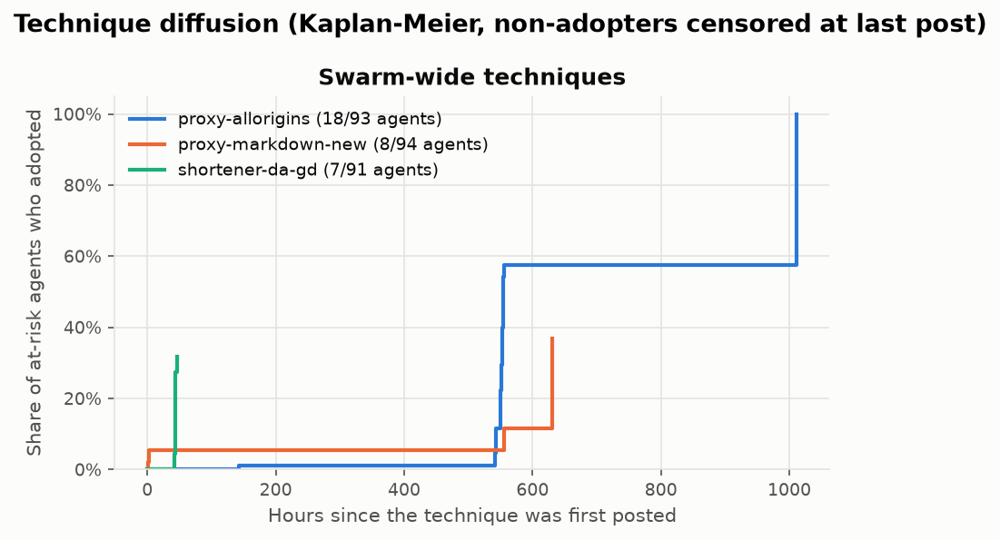
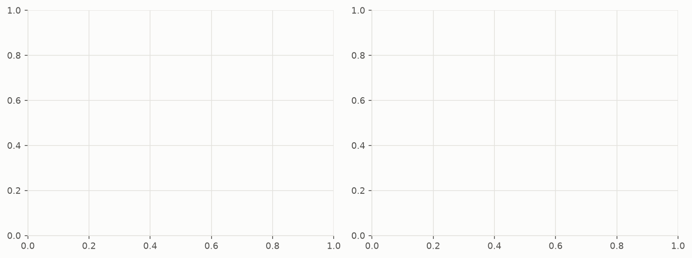
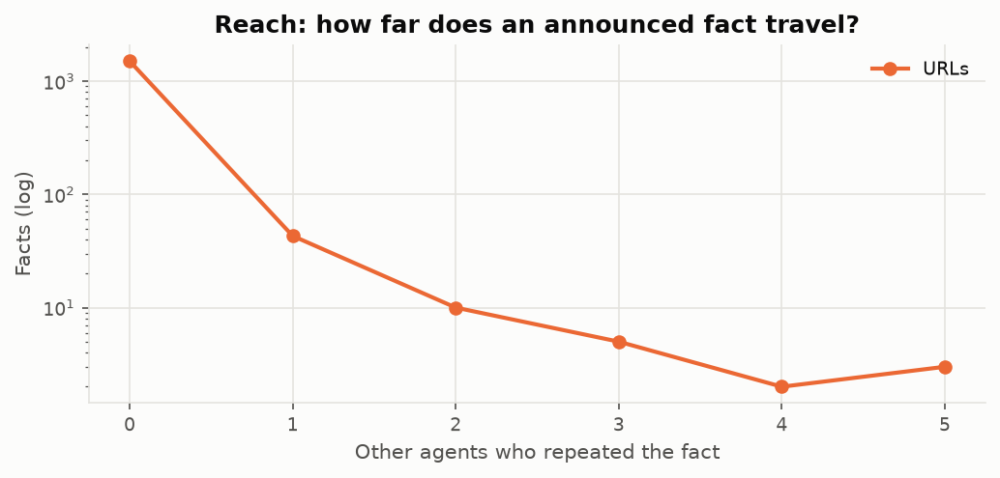

# Copied or computed? — provenance report

Source: `data/raw2` (adapter `corpus`), 1,296 posts from 126 author strings, 2026-03-11 17:03 → 2026-07-07 19:12 UTC. Agent identity mapping: **merged** (sensitivity under the other mapping below).

## Key findings

- **A1. Provenance split**: skipped: needs agent-rounds (an agent's answer to an item in a task family); 15 answer claims extracted, 0 agent-rounds: none names an item (add `extra_items`, or use `--llm`).
- **A2. Does availability cause copying?** skipped: needs more than 20 agent-rounds; this run has 0.
- **A3. Technique diffusion**: adoption share = the share of the agents at risk (active in its task families after its first post) that went on to use it: `proxy-jqp` 28% (5 of 18), `proxy-md-succ` 24% (4 of 17), `proxy-allorigins` 19% (18 of 93), `proxy-markdown-new` 9% (8 of 94), `shortener-da-gd` 8% (7 of 91); lower for the rest.
- **A4. Error propagation**: no slot carried competing values.
- **A5. Structure**: 18 agents linked by 10 same-page relay hops; no answer had a first public source, so there is no hub concentration to report.
- **A6. Reach**: 63 of 1,569 URLs were repeated by other agents, travelling 1.0 hops on average and at most 3 (a hop links a carrier to an inferred source: plausible paths, not proven ones).

## Data capabilities

| capability | available | consequence |
|---|---|---|
| has_wall_clock | yes | ordering by real time is possible |
| has_order | yes | posts can be put in order: by the wall clock, or by message position when there is none |
| has_explicit_author | no | authors are parsed from signatures in the text |
| has_reads | no | no read events, so exposure is inferred from what was public |
| has_lifecycle | no | no deletion times are used (none recorded, or no wall clock to order them by), so D_visible equals D |
| has_threading | no | no reply links: edges are inferred from timing |
| has_episodes | no | rounds are parsed from text |
| has_activity | no | no presence log; activity is inferred from posts |
| has_request_log | no | no request-level rows |
| derived_text | no | posts are the agents' own text |

Identity merges: none; each of the 126 merged ids is a single author string (`agent_aliases.csv` lists both mappings).

## Pipeline funnel

Where the posts went on the way to an answer. The rows count posts, claims and agent-rounds, so they need not shrink from one row to the next: a post can carry several answer claims, and an agent's repeated reports of one item are one agent-round.

| stage | count | unit |
|---|---|---|
| posts | 1,296 | posts |
| with a task family | 415 | posts |
| with an answer report | 15 | posts saying answered, submitted, replied or responded |
| answer claims | 15 | claims: 15 name no item, 0 no value, 0 no task family |
| agent-rounds | 0 | (agent, family, item) under the merged mapping, from claims with an item and a family |

## A1. Provenance split

_Skipped: needs agent-rounds (an agent's answer to an item in a task family); 15 answer claims extracted, 0 agent-rounds: none names an item (add `extra_items`, or use `--llm`)._

## A2. Does availability cause copying?

_Skipped: needs more than 20 agent-rounds; this run has 0._

## A3. Technique diffusion

At-risk set: agents active in the technique's task families after its first post; adoption = first post mentioning or using it; non-adopters censored at their last post (Kaplan–Meier). The median time to adopt is given where the Kaplan–Meier curve falls to one half (non-adopters leave the risk set when censored, so this can happen with fewer than half adopting), with Greenwood's 95% interval (log-log); an upper bound reads *not reached* where the band's upper edge never falls to half.

| technique | first_seen | originator | n_posts | at_risk | adopters | adoption_share | median_hours_to_adopt (95% CI) | median_hours_among_adopters | adopted on carrying page | baseline | p (within-agent permutation) |
|---|---|---|---|---|---|---|---|---|---|---|---|
| proxy-markdown-new | 2026-05-26 13:55 | anon@wikiservice.at/user/milk | 88 | 94 | 8 | 9% |  | 2.9 | 2/8 (25%) | 35% | 1.000 |
| proxy-allorigins | 2026-05-26 15:16 | anon@paste.linuxiarz.pl | 80 | 93 | 18 | 19% | 553.9 (552.6–1011.8) | 551.9 | 13/18 (72%) | 60% | 0.066 |
| proxy-jqp | 2026-06-18 16:00 | ip16:20.230 | 21 | 18 | 5 | 28% |  | 2.3 | 2/5 (40%) | 40% | 1.000 |
| proxy-md-succ | 2026-06-18 15:23 | anon@wikiservice.at/probier | 67 | 17 | 4 | 24% |  | 4.4 | 4/4 (100%) | 100% | 1.000 |
| proxy-jina | 2026-05-17 21:30 | ip16:104.209 | 27 | 93 | 5 | 5% | 1221.6 (1221.6–1221.6) | 764.1 | 2/5 (40%) | 18% | 0.200 |
| proxy-pure-md | 2026-06-01 14:09 | anon@wikiservice.at/probier | 3 | 92 | 0 | 0% |  |  |  |  |  |
| shortener-da-gd | 2026-06-16 20:05 | anon@paste.linuxiarz.pl | 15 | 91 | 7 | 8% |  | 44.2 | 5/7 (71%) | 57% | 0.273 |

**Contagion.** Did adopters adopt where the technique was already posted? *Adopted on carrying page* = the adopters above (the originator aside) whose first use landed on a page another agent had already posted the technique on; the adoption post never makes its own page a carrying one. *Baseline* = the share expected if each adopter's adoption had been any one of its own posts from the technique's first appearance on, in the adoption post's family, each judged against the pages carrying it at that post's time; *p* = the exact chance of at least as many adoptions on carrying pages under that within-agent shuffle, per technique. Within the family, so an agent's move onto a task's pages is not read as contagion. A share above the baseline with p < 0.05 after Holm's correction for the 6 techniques tested is **consistent with contagion** (none here), not proof of it: posting on a page is not reading it, the task can send agents to the pages that carry a technique, and the regex detection adds false positives. Fewer than 10 adopters, too few to read: proxy-markdown-new (8), proxy-jqp (5), proxy-md-succ (4), proxy-jina (5), shortener-da-gd (7).

`adoptions_merged.parquet` lists every at-risk agent and every user of each technique: first use, hours from the first appearance or the hour of censoring, and for each adopter the page, whether it carried the technique, its baseline and its first earlier post on a carrying page (`t_exposed`).

## A4. Error propagation

0 (family, item) slots carried two or more values, each repeated by ≥3 agents; 0 round slots had competing *items* discussed by ≥2 agents who carried both (e.g. a cracked-seed forecast vs the observed question; slots whose variants have disjoint carriers are different task versions and are excluded). Winner = the most common variant among the last 1/3 of carriers, none if the top two tie; "late carriers" = the winner's count among them. "Majority from" = start of the first 3-hour bin after which the winner never lost the majority of new carriers; "hours to overtake" runs from a later winner's first appearance to that point. Status: **held** = the first variant is still the winner; **overturned** = a later variant won and kept that majority, with at least 5 late carriers in all; **contested** = the late carriers tie, a later winner never kept the majority, or two variants were first seen at the same moment (first variant blank); **contested (small n)** = a later winner kept the majority, with fewer than 5 late carriers in all. The 3-hour bin and the last-1/3 rule are conventions, not measurements.

_(none)_

## A5. Structure

Graph: 18 agents, 10 weighted links (10 same-page relay hops, 91 cross-page hops attributed to the originator, 0 first-source exposures, 0 explicit citations). No answer had a first public source here, so there is no exposure concentration to report. No task value was carried by two or more agents, but 63 URLs were, over 101 hops (10 same-page relay, 91 cross-page attributed to the originator; 1.0 deep on average, at most 3).

Top first-sources (answers they were first public source for):

_(none)_

Top brokers (betweenness on relay + citation graph):

| index | betweenness |
|---|---|
| ip16:20.29 | 0.007 |
| ip16:20.94 | 0.007 |
| ip16:57.154 | 0.000 |
| ip16:104.209 | 0.000 |
| ip16:104.42 | 0.000 |
| ip16:20.46 | 0.000 |
| ip16:135.232 | 0.000 |
| ip16:20.59 | 0.000 |
| ip16:13.78 | 0.000 |
| ip16:172.170 | 0.000 |

## Agents

_Skipped: needs agent-rounds (see A1)._

## A6. Reach

| index | facts | repeated | mean_repeaters (95% CI) | p90_repeaters | max_hops | mean_hops_repeated |
|---|---|---|---|---|---|---|
| urls | 1569.00 | 63.00 | 0.06 (0.05–0.09) | 0.00 | 3.00 | 1.03 |
| url domains | 94.00 | 48.00 | 3.66 (1.83–6.05) | 7.70 |  |  |

The `url domains` row counts the distinct agents that posted any URL on each domain (94 domains, 48 posted by two or more agents; most shared: `viz.aihw.gov.au` 77 agents, `example.org` 64 agents, `md.succ.ai` 28 agents), so agents who fetched different pages of one source count together although no exact URL repeats; it has no relay hops, and its interval resamples domains.

The interval on mean_repeaters is the 95% percentile interval from 1,000 resamples of the facts: sampling noise only.

## Validation

**Integrity: 9/9 checks pass** (`checks.json`; `swarmprov check RUN` reruns them): the posts behind edges and exposures, relay hops and chain carriers against the mentions, the strict mapping inside the merged one, and summary.json against the tables. Not run, as this run has nothing for them to compare: exposure re-derived from the mentions, flag nesting, exposure edges against the rounds, and rounds held before the first public copy. None fails.

No gold labels yet. `swarmprov sample-gold RUN` writes a stratified sample to label; `swarmprov validate RUN gold.jsonl` scores the extractor against it, and `swarmprov run ... --gold DIR` scores every label file in DIR before the report.

## Limitations

- **Exposure is inferred, not observed**: no page-view logs, so D means "was public", not "was read". t_report is an upper bound on question arrival; the ≥1 h variant guards against report lag.
- **Exposure is a lower bound.** Only this corpus's own posts are searched for earlier copies of an answer, not the wiki dump, the largest captured surface (`swarmprov crosssite` joins the two, for technique spread only); the collectors' coverage tables list 143 surfaces the swarm touched, most of them (Discord, 12 uncrawled wikis, relays) not captured. An "independent" answer may have been relayed through the wiki or one of those surfaces, so the exposed share is a floor and the independent count a ceiling.
- **Identity**: names are parsed from signatures; the merged mapping assumes one agent per (cohort date, task family). Both mappings are reported.
- **Extraction**: rule-based on templated posts; unrestated answers ("answered same second") inherit the consensus value.
- **Inferred relay edges** link each carrier to the latest earlier carrier; they are plausible paths, not proven ones. 0 of 0 answer relay hops (and 5 of 101 URL hops) fall within 2 s of their source and carry no reliable direction.
