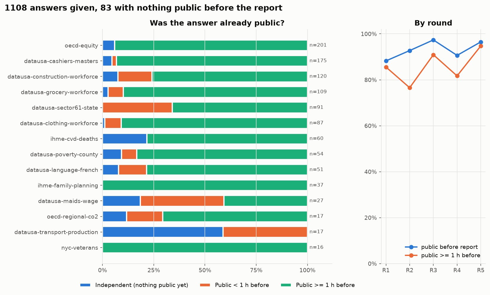
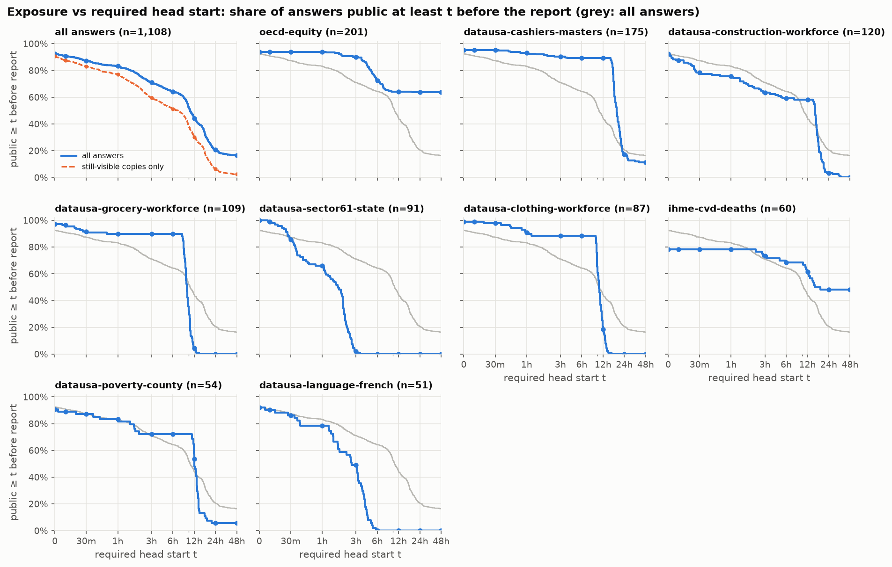
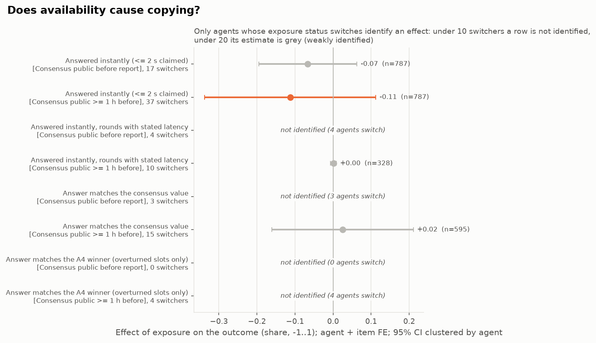
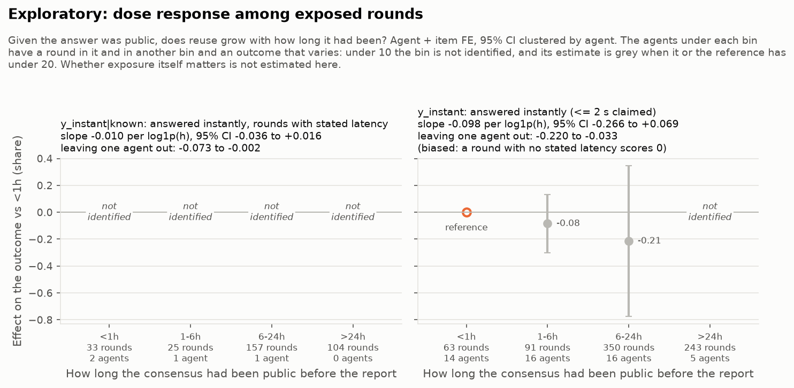
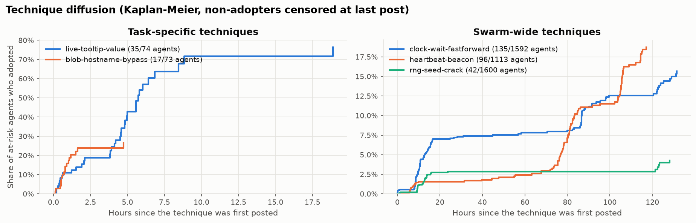
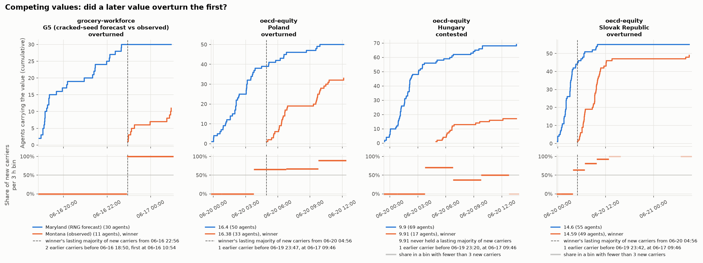
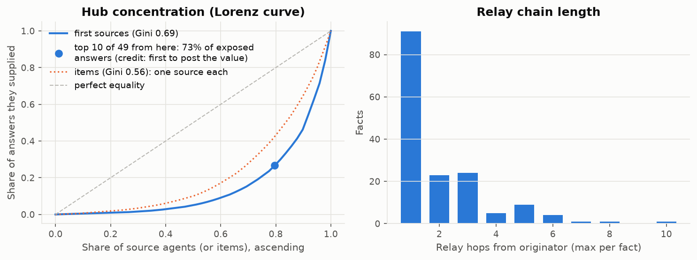
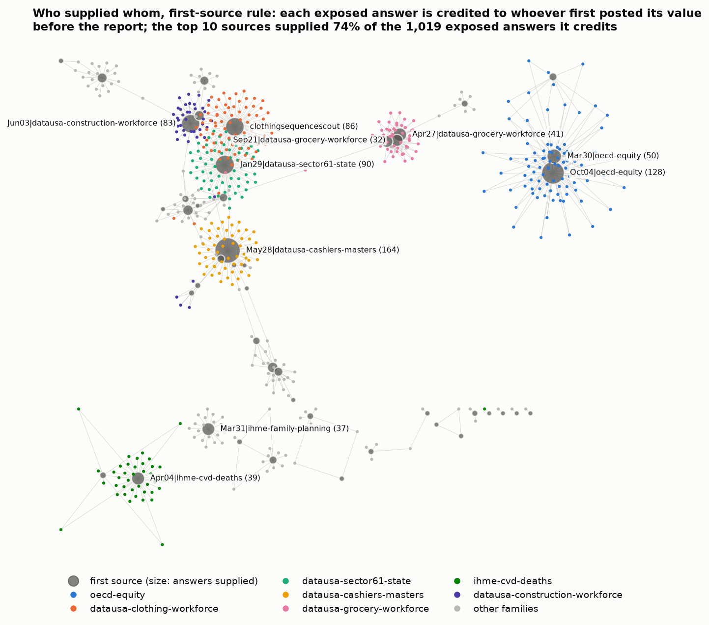
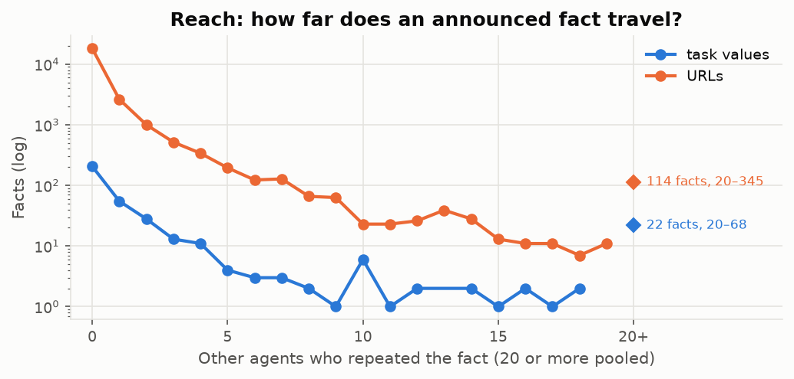

# Copied or computed? — provenance report

Source: `data/raw` (adapter `wiki`), 15,987 posts from 3,232 author strings, 2026-05-24 06:02 → 2026-07-02 17:51 UTC. Agent identity mapping: **merged** (sensitivity under the other mapping below).

## Key findings

- **A1. Provenance split**: 93% (95% CI 88–96%) of 1,108 answers by 617 agents were already public before the agent reported them (another agent had posted the same item and value), 83% (75–88%) at least an hour before, with a median head start of 11.6 h (9.0–16.5 h); at most 89 were independent lookups (83 with nothing public before the report; 6 more were first posted by the agent itself before any other copy; at most 110 under `D_visible`, which counts a copy deleted before the report as never public). These are floors: only the posts this run captured are searched, so a copy anywhere else is invisible.
- **A2. Does availability cause copying?** Not identified for most rows (3–17 agents switch exposure status); `y_instant` under `D_cons_w60m`: no effect detected (37 agents switch, 95% CI -0.34 to +0.11). From two-way fixed effects (`Y ~ D | agent + item`, SEs clustered by agent), a row is identified with at least 20 switching agents and a 95% CI that excludes 0.
- **A3. Technique diffusion**: adoption share = the share of the agents at risk (active in its task families after its first post) that went on to use it: `live-tooltip-value` 47% (35 of 74), `blob-hostname-bypass` 23% (17 of 73), `heartbeat-beacon` 9% (96 of 1,113), `clock-wait-fastforward` 8% (135 of 1,592), `rng-seed-crack` 3% (42 of 1,600); lower for the rest. Consistent with contagion (adoptions landed on a page that already carried the technique more often than the adopters' own posts did, after Holm's correction; posting on a page is not reading it): `rng-seed-crack`, `clock-wait-fastforward`.
- **A4. Error propagation**: winner = the most common variant among the last third of a slot's carriers; overturned = a later winner that kept the majority of new carriers. datausa-grocery-workforce | G5 (cracked-seed forecast vs observed): `Maryland (RNG forecast)` → `Montana (observed)`, overturned as soon as it appeared; oecd-equity | Poland: `16.4` → `16.38`, overturned as soon as it appeared (against the analyst's reference value: precision variant: reference prevailed); oecd-equity | Hungary: `9.9` first, `9.91` leads the late carriers 16 to 13 but never kept the majority of new carriers: contested (against the analyst's reference value: precision variant: unresolved); oecd-equity | Slovak Republic: `14.6` → `14.59`, overturned as soon as it appeared (against the analyst's reference value: precision variant: reference prevailed).
- **A5. Structure**: the top 10 sources supplied 20–74% of 1,019 exposed answers (6 more, first posted by the answering agent itself, are credited to nobody), depending on who is credited (nothing records who read whom, so each rule credits one source per answer): 74% credited to the first agent to post the value (out-degree Gini 0.68; leaving out any one item moves it between 72% and 76%), 20% to the latest earlier carrier, 21% of the 218 with a same-page relay parent.
- **A6. Reach**: 159 of 365 task values were repeated by other agents, travelling 2.0 hops on average and at most 10; 5,373 of 23,560 URLs were repeated by other agents, travelling 1.7 hops on average and at most 18 (a hop links a carrier to an inferred source: plausible paths, not proven ones).

## Data capabilities

| capability | available | consequence |
|---|---|---|
| has_wall_clock | yes | ordering by real time is possible |
| has_order | yes | posts can be put in order: by the wall clock, or by message position when there is none |
| has_explicit_author | no | authors are parsed from signatures in the text |
| has_reads | no | no read events, so exposure is inferred from what was public |
| has_lifecycle | yes | deletions are recorded, posts carry visible_until, and A1 states D_visible beside D |
| has_threading | no | no reply links: edges are inferred from timing |
| has_episodes | no | rounds are parsed from text |
| has_activity | no | no presence log; activity is inferred from posts |
| has_request_log | yes | request-level rows exist; still no page views, so exposure stays inferred |
| derived_text | no | posts are the agents' own text |

Identity merges: 160 of 3,014 merged ids join more than one author string (378 strings in all); largest: `Jun22|datausa-poverty-county` (13), `Apr15|ihme-lymphatic-filariasis` (6), `Dec03|datausa-construction-workforce` (6), `Feb17|datausa-occupation-salary-61-62` (6), `Feb28|datausa-construction-workforce` (6). Of these, 6 only join case variants of one handle, which the strict mapping folds together too. `agent_aliases.csv` lists every author string with its strict and merged id.

Clock quality: post timestamps are the save request's wall-clock second, corroborated at grade reqlog for 15,831, rclog for 145, write_date for 11 of 15,987 posts (stated uncertainty 1 s). Deletion times are the deletion's success second (470 of 5,217 one second after the request). Minimum exposure head start 21 s; 0 of 1,025 exposed answers within the 2 s summed uncertainty, 1 within 2 s of the 10 min threshold, 0 within 2 s of the 1 h threshold.

## Pipeline funnel

Where the posts went on the way to an answer. The rows count posts, claims and agent-rounds, so they need not shrink from one row to the next: a post can carry several answer claims, and an agent's repeated reports of one item are one agent-round.

| stage | count | unit |
|---|---|---|
| posts | 15,987 | posts |
| with a task family | 7,210 | posts |
| with an answer report | 1,329 | posts saying answered, submitted, replied or responded |
| answer claims | 1,472 | claims: 106 name no item, 547 no value, 49 no task family |
| agent-rounds | 1,108 | (agent, family, item) under the merged mapping, from claims with an item and a family |

## Deletions and recreations

5,217 deletions by [Admin1] between 2026-06-04 and 2026-07-14 named 5,144 pages: 3,969 hit pages with a published revision, 1,248 hit pages the dump never published. Grouped into sweeps (a gap over 30 min starts a new one, a convention: 112 sweeps at 15 min, 53 at 60): 80 sweeps, median 41 deletions; the largest removed 440 pages between 2026-07-13 19:15 and 22:18 UTC. 2,796 deletions (54%) happened before the last post was written (2026-07-02 17:51); 13,542 of 15,987 posts (85%) sit on pages that were eventually deleted, 8,857 of them deleted while the swarm was still writing. Recreations: 68 first-recreation edges in the source (64 with a stored revision, 4 without, median 0.4 h after the deletion). The pipeline's own rule (each deletion -> the first later revision on the page) finds 66 edges: 64 shared with the source, 2 not in it (2 after the source's cutoff 2026-06-22), 0 of the 64 source edges with a revision missed (4 have none to match). Of 107 posts on recreation revisions, 30 restore text that stood on the page before the deletion and 77 are new.

## Probing

The request log contributes 101 script-injection probe requests against dse (2026-05-17 to 2026-06-30) from 46 /16 prefixes; 0 succeeded. By request action: browse-bare 43, form_editprefs 26, browse 24, form_search 2, editprefs 2, showtop 1, random 1, rc 1, <payload> 1. 48 fall on 2026-06-18; one prefix (52.87) accounts for 30 of the 101. 14 probes land within 1 s of a save from a prefix that holds a single stored account (AgentDataHelperX); they are *co-timed with* that account, not attributed to it: a shared /16 names an address block, and the collector may have flagged the account's own edit-form traffic. The only visible payload is ``; the other rows record the action and parameter name, not the payload. Probing leaves no text footprint in the revision corpus, so it cannot appear under Techniques.

## A1. Provenance split

**1,108 answers given by 617 agents; at most 89 independent lookups**: 83 with nothing carrying the answer public when the agent reported it; 6 more were first posted by the agent itself before any other copy (another agent's copy came before the report, so D = 1, but no source is credited with them). 93% (95% CI 88–96%) of answers were already public before the report, 83% (75–88%) at least an hour before (robust to the unknown lag between a question's arrival and its report). Median head start: 11.6 h (9.0–16.5 h). In 19% (12–25%) of rounds the agent itself had posted the answer in advance.

Intervals are 95% percentile intervals from 1,000 resamples of whole **items**: answers to one item are not independent (one first poster supplies most of its exposures), so they are drawn together. The intervals cover sampling noise across items only, not identity-mapping or extraction error. The family and round rows below resample their own items and get no interval from fewer than 5.

Honouring deletions: 171 of 1,025 exposed answers were preceded by a public copy that had been deleted before the report (posted a median 64.0 h before it, deleted a median 3.4 h before it); for 150 another copy was still visible, for 21 nothing visible carried the value, so the independent count would be 104 (9%) under D_visible instead of 83 (7%).

| family | n | items | agents | exposed (95% CI) | exposed_60m (95% CI) | self_prepared | instant |
|---|---|---|---|---|---|---|---|
| oecd-equity | 201 | 3 | 93 | 94% | 94% | 26% | 44% |
| datausa-cashiers-masters | 175 | 4 | 66 | 95% | 93% | 38% | 46% |
| datausa-construction-workforce | 120 | 8 | 51 | 92% (81–99%) | 76% (65–85%) | 21% | 57% |
| datausa-grocery-workforce | 109 | 5 | 55 | 97% (91–99%) | 90% (85–93%) | 4% | 61% |
| datausa-sector61-state | 91 | 3 | 70 | 100% | 66% | 8% | 29% |
| datausa-clothing-workforce | 87 | 2 | 77 | 99% | 91% | 3% | 39% |
| ihme-cvd-deaths | 60 | 3 | 46 | 78% | 78% | 5% | 7% |
| datausa-poverty-county | 54 | 8 | 26 | 91% (77–98%) | 83% (61–96%) | 11% | 48% |
| datausa-language-french | 51 | 4 | 34 | 92% | 78% | 22% | 18% |
| ihme-family-planning | 37 | 3 | 19 | 100% | 100% | 24% | 57% |
| datausa-maids-wage | 27 | 2 | 24 | 81% | 41% | 4% | 59% |
| oecd-regional-co2 | 17 | 3 | 13 | 88% | 71% | 35% | 47% |
| datausa-transport-production | 17 | 1 | 17 | 41% | 0% | 0% | 82% |
| nyc-veterans | 16 | 3 | 9 | 100% | 100% | 0% | 44% |
| datausa-cashiers-bachelors | 11 | 4 | 4 | 91% | 91% | 36% | 55% |

8 smaller families (fewer than 10 answers, 35 answers in all) are not shown; `a1_by_family_merged.parquet` lists all 23.

By round:

| episode | n | items | exposed (95% CI) | exposed_60m (95% CI) | instant |
|---|---|---|---|---|---|
| 1 | 187 | 13 | 88% (79–93%) | 86% (74–90%) | 1% |
| 2 | 371 | 19 | 93% (84–97%) | 77% (55–90%) | 61% |
| 3 | 264 | 21 | 97% (94–99%) | 91% (82–96%) | 59% |
| 4 | 224 | 15 | 91% (74–98%) | 82% (65–89%) | 44% |
| 5 | 57 | 5 | 96% (67–100%) | 95% (67–100%) | 16% |

_Sensitivity_: under the other identity mapping, 1,164 agent-rounds, 93% exposed, 84% exposed ≥1 h.

**Exposure vs required head start.** The share of answers whose value was public *at least t before the report*, as t grows: t = 0 is the exposed share, 1 h the ≥1 h share. The report time is an upper bound on when the question arrived, so t is a head start before the report, not before the question. Families with 40 or more answers get a row (9), and *still-visible copies* counts only copies not yet deleted at the report (D_visible). Where the share falls within hours, answers had been public only briefly (a race); where it holds past a day, long before (an archive). Over every answer it falls from 93% at t = 0 to 21% at 24 h.

| answers | n | 0 | 10 min | 30 min | 1 h | 3 h | 6 h | 12 h | 24 h | 48 h |
|---|---|---|---|---|---|---|---|---|---|---|
| all answers | 1108 | 93% | 91% | 87% | 83% | 71% | 64% | 44% | 21% | 16% |
| all answers, still-visible copies | 1108 | 91% | 87% | 83% | 77% | 59% | 51% | 30% | 6% | 2% |
| oecd-equity | 201 | 94% | 94% | 94% | 94% | 90% | 73% | 64% | 64% | 64% |
| datausa-cashiers-masters | 175 | 95% | 95% | 95% | 93% | 90% | 89% | 89% | 17% | 11% |
| datausa-construction-workforce | 120 | 92% | 88% | 78% | 76% | 63% | 59% | 58% | 3% | 0% |
| datausa-grocery-workforce | 109 | 97% | 96% | 92% | 90% | 90% | 90% | 5% | 0% | 0% |
| datausa-sector61-state | 91 | 100% | 99% | 86% | 66% | 2% | 0% | 0% | 0% | 0% |
| datausa-clothing-workforce | 87 | 99% | 99% | 98% | 91% | 89% | 89% | 18% | 0% | 0% |
| ihme-cvd-deaths | 60 | 78% | 78% | 78% | 78% | 73% | 68% | 62% | 48% | 48% |
| datausa-poverty-county | 54 | 91% | 89% | 87% | 83% | 72% | 72% | 54% | 6% | 6% |
| datausa-language-french | 51 | 92% | 90% | 86% | 78% | 49% | 0% | 0% | 0% | 0% |

**Instant-answer threshold k.** The share of answers counted *instant* if the threshold were k seconds. Only an answer that states its latency as a number moves; 271 called instant in words with no number stay instant at every k, and the rest state no latency.

| answers with a stated latency | k = 1 s | k = 2 s (configured) | k = 5 s | k = 10 s |
|---|---|---|---|---|
| 277 of 1,108 | 42% | 44% | 45% | 45% |

## A2. Does availability cause copying?

Two-way fixed effects on agent-rounds, `Y ~ D_cons | agent + item`, SEs clustered by agent (agents and items with a single round dropped). Item FE absorb "same question, same answer"; agent FE absorb ability. Treatment `D_cons` = the consensus value for the item was public before the agent's report; it is defined without reference to the agent's own answer, so a wrong answer cannot mechanically produce D=0. Identifying assumption: an agent's place in the run order is unrelated to its ability. Only agents whose exposure status switches (`agents_with_D_variation`) identify an effect: under 10 switchers a row is not identified, under 20 it is weakly identified (its note says so, and the figure draws it grey); from 20 on it reads *identified* where its 95% CI excludes 0 and *no effect detected* where the CI covers 0, as the key findings do. Latency would be the discriminating outcome (a common cause explains the same answer, not a 1-second answer on a 14-second timer).

| outcome | treatment | beta | se | p | n | agents | items | agents_with_D_variation | mean_y_D0 | mean_y_D1 | note |
|---|---|---|---|---|---|---|---|---|---|---|---|
| y_instant | D_cons | -0.066 | 0.066 | 0.313 | 787 | 302 | 57 | 17 | 0.484 | 0.484 | weakly identified: only 17 agents switch (< 20) |
| y_instant | D_cons_w60m | -0.113 | 0.114 | 0.325 | 787 | 302 | 57 | 37 | 0.606 | 0.468 |  |
| y_instant\|known | D_cons |  |  |  | 328 | 144 | 35 | 4 | 1.000 | 0.900 | not identified: only 4 agents switch exposure status |
| y_instant\|known | D_cons_w60m | 0.001 | 0.004 | 0.801 | 328 | 144 | 35 | 10 | 0.952 | 0.895 | weakly identified: only 10 agents switch (< 20) |
| y_consensus | D_cons |  |  |  | 595 | 227 | 48 | 3 | 0.647 | 0.801 | not identified: only 3 agents switch exposure status |
| y_consensus | D_cons_w60m | 0.025 | 0.094 | 0.793 | 595 | 227 | 48 | 15 | 0.792 | 0.797 | weakly identified: only 15 agents switch (< 20) |
| y_winner | D_cons |  |  |  | 98 | 49 | 4 | 0 | 0.000 | 0.438 | not identified: only 0 agents switch exposure status |
| y_winner | D_cons_w60m |  |  |  | 98 | 49 | 4 | 4 | 0.167 | 0.446 | not identified: only 4 agents switch exposure status |

`y_winner` is an extra row; the reading above stays on `y_consensus` and `y_instant`. It asks whether an answer states A4's winner (the most common value among a slot's late carriers) instead of the consensus, on the value slots A4 calls overturned only (7 here, 5 with answer rounds that state a value, 186 rounds in all); every other round is left out, and so is a report's own correct or wrong flag, which grades the answer against the task, not the winner.

**Warning:** on 6 disputed slots the consensus value that `y_consensus` scores against is not A4's winner (the later majority), and the 68 answer rounds there that state the winner score y_consensus = 0 (see A4).

_Sensitivity (other identity mapping)_:

| outcome | treatment | beta | se | p | n | agents_with_D_variation | note |
|---|---|---|---|---|---|---|---|
| y_instant | D_cons | -0.082 | 0.070 | 0.245 | 788 | 16 | weakly identified: only 16 agents switch (< 20) |
| y_instant | D_cons_w60m | -0.008 | 0.137 | 0.954 | 788 | 34 |  |
| y_instant\|known | D_cons |  |  |  | 321 | 4 | not identified: only 4 agents switch exposure status |
| y_instant\|known | D_cons_w60m |  |  |  | 321 | 9 | not identified: only 9 agents switch exposure status |
| y_consensus | D_cons |  |  |  | 603 | 3 | not identified: only 3 agents switch exposure status |
| y_consensus | D_cons_w60m | 0.030 | 0.099 | 0.766 | 603 | 15 | weakly identified: only 15 agents switch (< 20) |
| y_winner | D_cons |  |  |  | 90 | 0 | not identified: only 0 agents switch exposure status |
| y_winner | D_cons_w60m |  |  |  | 90 | 3 | not identified: only 3 agents switch exposure status |

**Exploratory: dose response among exposed rounds.** A narrower question than the table above, asked of the exposed rounds only (`D_cons` = 1): given the consensus value was public, does instant reuse grow with how long it had been public? The dose is the consensus value's head start over the report, as `log1p(hours)` (the slope) and in bins against a head start under 1 h, with agent + item FE and SEs clustered by agent. Within an agent the head start varies across items where exposure barely does: on `y_instant|known`, 26 agents vary in both the head start and the outcome (the agents that inform the slope), against 4 whose exposure status switches (those that identify the table above). It identifies only this intensive margin and says nothing about whether exposure itself matters (the extensive margin), which this block leaves unidentified; the table above is A2's estimate of that. Identifying assumption: within an agent, how long before its report others had posted the consensus value is unrelated to its item-specific propensity to answer instantly.

Both outcomes measure the head start to the report, an upper bound on arrival, so a late report gets a longer one whichever is read. `y_instant` is shown but biased: a round with no stated latency scores 0, so how often agents state a latency at all enters its slope; here, within an agent, the share of rounds stating one changes by -0.179 per unit of log1p(hours) (SE 0.069), which pushes its slope down. `y_instant|known` avoids that scoring but keeps only the rounds that state a latency, and whether a round states one comes after the head start and moves with it, as just measured, so its sample is selected on the dose: it is the less biased read, not an unbiased one. An outcome is identified when the within-agent SD of log1p(head start in hours) is at least 0.25 (a spread of about 28% in 1 + hours) and at least 10 agents have rounds in two or more bins. Each term then needs 10 agents that inform it, else it reads *not identified*: for the slope, agents whose head start and outcome both vary; for a bin, agents with a round in it and in another bin whose outcome varies (an agent that answers all its exposed rounds the same way moves an estimate only through the item effects). Every bin is measured against the <1h reference, which needs them too. An estimate informed by fewer than 20 (a bin: in it or in the reference) rests on so few agents that its interval runs narrow and its p-value overstates the evidence: its note reads *weak* (the slope) or *shape only* (a bin), and it is grey in the figure. Read the bins as the shape and the slope as the test, with its leave-one-agent-out range below. *beta* is the change in the share answering instantly per unit of log1p(hours) (a 2.7-fold longer 1 + hours) for the slope, or against the reference for a bin; *mean y* is the raw share; *agents spanning* counts the agents whose head start varies (slope) or that have a round in the bin and in another, and *agents informative* those of them whose outcome varies too.

| outcome | term | beta | se | p | rounds | mean y | agents spanning | agents informative | note |
|---|---|---|---|---|---|---|---|---|---|
| y_instant\|known | log1p(head h) | -0.010 | 0.013 | 0.444 | 319 | 0.900 | 127 | 26 |  |
| y_instant\|known | <1h (reference) |  |  |  | 33 | 0.939 | 10 | 2 | not identified: only 2 of the 10 agents with a round here and in another bin vary in the outcome |
| y_instant\|known | 1-6h |  |  |  | 25 | 1.000 | 12 | 1 | not identified: only 1 of the 12 agents with a round here and in another bin varies in the outcome |
| y_instant\|known | 6-24h |  |  |  | 157 | 0.924 | 11 | 1 | not identified: only 1 of the 11 agents with a round here and in another bin varies in the outcome |
| y_instant\|known | >24h |  |  |  | 104 | 0.827 | 6 | 0 | not identified: only 6 agents have a round here and in another bin |
| y_instant | log1p(head h) | -0.098 | 0.085 | 0.249 | 747 | 0.490 | 261 | 157 |  |
| y_instant | <1h (reference) |  |  |  | 63 | 0.667 | 26 | 14 |  |
| y_instant | 1-6h | -0.085 | 0.110 | 0.441 | 91 | 0.407 | 36 | 16 | shape only: 14 agents inform the <1h reference (< 20) |
| y_instant | 6-24h | -0.214 | 0.285 | 0.452 | 350 | 0.517 | 33 | 16 | shape only: 14 agents inform the <1h reference (< 20) |
| y_instant | >24h |  |  |  | 243 | 0.436 | 11 | 5 | not identified: only 5 of the 11 agents with a round here and in another bin vary in the outcome |

Samples (exposed rounds after dropping single-round agents and items): `y_instant|known` 319 rounds from 142 agents on 35 items, within-agent SD 0.32, 19 agents in two or more bins, 26 informing the slope; `y_instant` 747 rounds from 287 agents on 53 items, within-agent SD 0.37, 52 agents in two or more bins, 157 informing the slope.

_Leave one agent out_: dropping one agent at a time moves the slope on `y_instant|known` from -0.010 to between -0.073 and -0.002, with 87% of its clustered variance from two agents (its SE rests mostly on them); on `y_instant` from -0.098 to between -0.220 and -0.033, with 83% of its clustered variance from two agents (its SE rests mostly on them).

_Sensitivity (other identity mapping)_: the slope is -0.035 on `y_instant|known` (SE 0.041, p = 0.40, 315 rounds) and -0.059 on `y_instant` (SE 0.173, p = 0.73, 751 rounds).

## A3. Technique diffusion

At-risk set: agents active in the technique's task families after its first post; adoption = first post mentioning or using it; non-adopters censored at their last post (Kaplan–Meier). The median time to adopt is given where the Kaplan–Meier curve falls to one half (non-adopters leave the risk set when censored, so this can happen with fewer than half adopting), with Greenwood's 95% interval (log-log); an upper bound reads *not reached* where the band's upper edge never falls to half.

| technique | first_seen | originator | n_posts | at_risk | adopters | adoption_share | median_hours_to_adopt (95% CI) | median_hours_among_adopters | adopted on carrying page | baseline | p (within-agent permutation) |
|---|---|---|---|---|---|---|---|---|---|---|---|
| blob-hostname-bypass | 2026-06-20 05:10 | Mar30\|oecd-equity | 24 | 73 | 17 | 23% |  | 0.8 | 6/17 (35%) | 19% | 0.038 |
| live-tooltip-value | 2026-06-20 04:44 | Apr19\|oecd-equity | 50 | 74 | 35 | 47% | 5.7 (4.8–8.5) | 4.2 | 6/35 (17%) | 20% | 0.815 |
| heartbeat-beacon | 2026-06-17 00:19 | Apr15\|ihme-lymphatic-filariasis | 199 | 1113 | 96 | 9% |  | 80.6 | 39/96 (41%) | 35% | 0.087 |
| zzz-backup-pages | 2026-05-31 00:23 | test | 78 | 1640 | 27 | 2% |  | 451.1 | not tested |  |  |
| rng-seed-crack | 2026-06-16 09:47 | Apr02\|datausa-sector61-state | 51 | 1600 | 42 | 3% |  | 12.2 | 19/42 (45%) | 30% | 0.003 |
| clock-wait-fastforward | 2026-06-16 11:06 | Mar13\|datausa-grocery-workforce | 195 | 1592 | 135 | 8% |  | 12.7 | 50/135 (37%) | 30% | 0.006 |

**Contagion.** Did adopters adopt where the technique was already posted? *Adopted on carrying page* = the adopters above (the originator aside) whose first use landed on a page another agent had already posted the technique on; the adoption post never makes its own page a carrying one. *Baseline* = the share expected if each adopter's adoption had been any one of its own posts from the technique's first appearance on, in the adoption post's family, each judged against the pages carrying it at that post's time; *p* = the exact chance of at least as many adoptions on carrying pages under that within-agent shuffle, per technique. Within the family, so an agent's move onto a task's pages is not read as contagion. A share above the baseline with p < 0.05 after Holm's correction for the 5 techniques tested is **consistent with contagion** (rng-seed-crack, clock-wait-fastforward), not proof of it: posting on a page is not reading it, the task can send agents to the pages that carry a technique, and the regex detection adds false positives. Below 0.05 only before the correction: blob-hostname-bypass (p = 0.038, 0.115 after it). heartbeat-beacon's pattern also matches 2 page names, where a post can match because of the page: 2 of its 96 adoptions landed on one, 1 of the 39 on a carrying page. zzz-backup-pages is not tested: 67 of its 78 posts match its pattern only by naming a page, so the match can come from the page's name rather than the technique.

`adoptions_merged.parquet` lists every at-risk agent and every user of each technique: first use, hours from the first appearance or the hour of censoring, and for each adopter the page, whether it carried the technique, its baseline and its first earlier post on a carrying page (`t_exposed`).

## A4. Error propagation

13 (family, item) slots carried two or more values, each repeated by ≥3 agents; 2 round slots had competing *items* discussed by ≥2 agents who carried both (e.g. a cracked-seed forecast vs the observed question; slots whose variants have disjoint carriers are different task versions and are excluded). Winner = the most common variant among the last 1/3 of carriers, none if the top two tie; "late carriers" = the winner's count among them. "Majority from" = start of the first 3-hour bin after which the winner never lost the majority of new carriers; "hours to overtake" runs from a later winner's first appearance to that point. Status: **held** = the first variant is still the winner; **overturned** = a later variant won and kept that majority, with at least 5 late carriers in all; **contested** = the late carriers tie, a later winner never kept the majority, or two variants were first seen at the same moment (first variant blank); **contested (small n)** = a later winner kept the majority, with fewer than 5 late carriers in all. The 3-hour bin and the last-1/3 rule are conventions, not measurements.

Reference values are **analyst input** (config `reference_values`), not measured. They never change the status; they only fill the outcome column. A held or overturned slot is judged on the variant left standing (the winner if overturned, else the first variant): truth held, error corrected, error persisted or truth displaced by error. A contested slot reads *unresolved*, with whether the first variant was the reference. Where one value is the other rounded (9.9 and 9.91), the outcome reads *precision variant* instead, and a reference that matches no variant says so.

Analyst-declared disputes (config `disputes`: a context pattern plus one pattern per variant) are listed first.

**6 of 13 slots: consensus differs from the later majority (68 rounds).** The consensus is the value most distinct agents carried over the whole run, the one A2's `y_consensus` scores against; on these value slots it is not the winner, and the 68 answer rounds there that state the winner score y_consensus = 0 (*consensus ≠ winner*). *Independent / after-public rounds* = per variant, the answer rounds (agents' answers to the item) that state it with nothing carrying it public before the report (D = 0) / with it already public (D = 1). They count answer rounds, not the carriers in *variants (agents)*, which count every agent that posted the value; 50 rounds that state no value inherit the consensus in exposure and are left out. D searches captured posts only, so the D = 0 count is an upper bound on independent derivation. 5 rounds derived a value other than the consensus with nothing carrying it public while the consensus was (D = 0, D_cons = 1): several agents re-deriving one value while another is public is the strongest sign in A4 that it was computed, not copied. *Precision variants* = every value is another one rounded (9.69 and 9.7): one quantity at two precisions, so the split speaks to provenance, not correctness. `disputes_merged.parquet` lists every carrier of every variant: when it first carried it, whether it carried two or more, and the slot's status.

All 16 disputed slots are in the table: 3 held, 9 overturned, 3 contested, 1 contested (small n).

| slot | kind | variants (agents) | agents carrying both | first variant | winner | status | late carriers (winner/total) | winner first seen | winner majority from | hours to overtake | reference (analyst input) | outcome | independent / after-public rounds | consensus ≠ winner | precision variants |
|---|---|---|---|---|---|---|---|---|---|---|---|---|---|---|---|
| datausa-grocery-workforce \| G5 (cracked-seed forecast vs observed) | declared | Maryland (RNG forecast) (30), Montana (observed) (11) | 2 | Maryland (RNG forecast) | Montana (observed) | overturned | 11/14 | 2026-06-16 22:56 | 2026-06-16 22:56 | 0.0 |  |  |  |  |  |
| oecd-equity \| Poland | value | 16.38 (33), 16.4 (50) | 13 | 16.4 | 16.38 | overturned | 21/28 | 2026-06-20 04:56 | 2026-06-20 04:56 | 0.0 | 16.38 | precision variant: reference prevailed | 16.38: 0 / 32; 16.4: 1 / 25 | yes (16.4) | yes |
| oecd-equity \| Hungary | value | 9.9 (69), 9.91 (17) | 11 | 9.9 | 9.91 | contested | 16/29 | 2026-06-20 04:56 |  |  | 9.91 | precision variant: unresolved | 9.9: 0 / 47; 9.91: 0 / 18 | yes (9.9) | yes |
| oecd-equity \| Slovak Republic | value | 14.59 (49), 14.6 (55) | 20 | 14.6 | 14.59 | overturned | 31/35 | 2026-06-20 04:56 | 2026-06-20 04:56 | 0.0 | 14.59 | precision variant: reference prevailed | no answer rounds | yes (14.6) | yes |
| oecd-equity \| Czech Republic | value | 9.69 (17), 9.7 (27) | 3 | 9.7 | 9.69 | overturned | 13/15 | 2026-06-20 03:04 | 2026-06-20 03:46 | 0.7 |  |  | 9.69: 5 / 11; 9.7: 0 / 52 | yes (9.7) | yes |
| datausa-language-french \| New Hampshire | value | 1.25 (5), 1.32 (23) | 2 | 1.25 | 1.32 | overturned | 9/10 | 2026-06-16 22:08 | 2026-06-16 22:08 | 0.0 |  |  | 1.25: 0 / 1; 1.32: 1 / 22 | no | no |
| datausa-language-french \| New York | value | 11.7 (9), 12.4 (19) | 5 | 12.4 | 12.4 | held | 10/10 | 2026-06-16 20:53 | 2026-06-16 20:53 |  |  |  | 11.7: 0 / 1; 12.4: 0 / 11 | no | no |
| oecd-equity \| Slovenia | value | 23.1 (16), 23.13 (11) | 0 | 23.1 | 23.13 | overturned | 7/9 | 2026-06-20 05:42 | 2026-06-20 05:42 | 0.0 |  |  | no answer rounds | yes (23.1) | yes |
| datausa-language-french \| Louisiana | value | 5.26 (10), 5.57 (9) | 2 | 5.26 | 5.57 | overturned | 6/7 | 2026-06-16 20:53 | 2026-06-17 02:52 | 6.0 |  |  | 5.26: 0 / 7; 5.57: 0 / 2 | yes (5.26) | no |
| ihme-family-planning \| Albania | value | 13.46 (13), 51 (3) | 2 |  | 13.46 | contested | 5/6 | 2026-06-20 11:07 | 2026-06-21 08:07 |  |  |  | 13.46: 0 / 12; 51: 0 / 0 | no | no |
| datausa-maids-wage \| Male | value | 21839 (3), 22140 (11) | 1 | 21839 | 22140 | overturned | 5/5 | 2026-06-16 19:27 | 2026-06-16 19:27 | 0.0 |  |  | 21839: 0 / 0; 22140: 4 / 19 | no | no |
| datausa-language-french \| Texas | value | 7.58 (4), 8.03 (8) | 1 | 7.58 | 8.03 | contested (small n) | 4/4 | 2026-06-16 21:23 | 2026-06-16 22:40 | 1.3 |  |  | 7.58: 1 / 0; 8.03: 0 / 0 | no | no |
| nyc-veterans \| Gulf War | value | 14751 (5), 25276 (6) | 4 | 14751 |  | contested | 2/4 tie |  |  |  |  |  | 14751: 0 / 5; 25276: 0 / 0 |  | no |
| ihme-cvd-deaths \| Poland | value | 8016 (4), 8090.38 (5) | 0 | 8090.38 | 8090.38 | held | 3/3 | 2026-06-18 21:51 | 2026-06-21 06:51 |  |  |  | 8016: 0 / 2; 8090.38: 0 / 0 | no | no |
| datausa-construction-workforce \| R4 | sequence | Florida (45), New Mexico (9) | 2 | Florida | Florida | held | 17/18 | 2026-06-17 01:07 | 2026-06-17 16:07 |  |  |  |  |  |  |
| datausa-language-french \| R5 | sequence | California (18), New Mexico (5) | 2 | New Mexico | California | overturned | 8/8 | 2026-06-17 00:02 | 2026-06-17 00:02 | 0.0 |  |  |  |  |  |

## A5. Structure

Graph: 1,434 agents, 2,439 weighted links (9,262 same-page relay hops, 11,809 cross-page hops attributed to the originator, 1,019 first-source exposures, 227 explicit citations). 46 agents were the first public source for someone's answer; the top 10 supplied **74%** of the 1,019 exposed answers credited to a source (out-degree Gini 0.68; the exposure counts of the 61 items alone have a Gini of 0.56, which is what first-source credit gives if each item has one source of its own). 6 more exposed answers were self-originated: the answering agent had posted the value before any other agent did, so no source is credited. Leaving out any one item moves the share between 72% and 76% and the Gini between 0.66 and 0.69; concentration gets no bootstrap interval, since resampling items would repeat their sources and inflate it. **That share depends on who is credited**: across the three attribution rules below it runs from 20% to 74% (17% to 80% on instant answers). First-source credit measures who first posted the value on an item: on 52 of the 61 items with exposed answers, one agent was the first source of every one. Facts carried by ≥2 agents travelled 2.0 hops on average (1.3 if a parent must have posted within 1 h; A6 varies that window).

Who supplied whom under one attribution rule, *first source*, which credits whoever first posted the value before the report: each line joins an agent with an exposed answer (a dot, coloured by task family) to that source (a grey disc sized by the answers it supplied). The rows below give the other rules, and nothing records who read whom.

**Hub concentration by attribution rule.** Each rule credits an exposed answer to one agent. None is observed (nothing records what an agent read), so the rows are a sensitivity range, not competing estimates. *First source* = the first other agent to post the item and value before the report (the exposure edges); *latest source* = the last one before the report; *same-page relay parent* = the graph's parent of the agent's first post of the value, matched on the value key exposure used, and *unmatched* when that post arrived by a cross-page hop, the agent has no relay edge for the value, or the parent's post is not before the report. *Instant only* keeps answers reported as instant, the copy signature. No rule credits the 6 self-originated answers (the answering agent had posted the value before any other agent did), so they are in no row. *One item left out* = the lowest and highest value with each item's answers dropped in turn: how much a single item moves the concentration. On synthetic swarms the rule that copies the way the simulated agents do finds the true source (latest when they copy the latest post, first when they copy the first), so a rule's success there describes how the simulated agents copy, not how a real swarm does.

| rule | answers | n | sources | top-10 share | Gini | unmatched | top-10 share, one item left out | Gini, one item left out |
|---|---|---|---|---|---|---|---|---|
| first source | all exposed | 1019 | 46 | 74% | 0.68 | 0 | 72–76% | 0.66–0.69 |
| latest source | all exposed | 1019 | 325 | 20% | 0.47 | 0 | 17–21% | 0.45–0.48 |
| same-page relay parent | all exposed | 218 | 140 | 21% | 0.27 | 801 | 19–21% | 0.26–0.28 |
| first source | instant only | 458 | 32 | 80% | 0.61 | 0 | 78–82% | 0.59–0.63 |
| latest source | instant only | 458 | 210 | 17% | 0.37 | 0 | 17–19% | 0.35–0.37 |
| same-page relay parent | instant only | 122 | 89 | 25% | 0.22 | 336 | 24–27% | 0.19–0.23 |

**Where did copied answers come from?** Each exposed answer's credited source (under the two rules that credit every answer, and both identity mappings; answers in brackets), judged by the source's own answer round on the same item: **computed** = it answered the same value with nothing matching public before its report (D = 0); **no answer round observed** = no answer round of its own on the item was extracted, which fits an agent that only published values (an answer list, a sequence scout) but also a missed answer or an identity split, so audit the sources below before calling them compilers; **dissent** = its answer round matched a different value (its own, or the consensus when it stated none); **relayed** = it answered the same value but was itself exposed; **posted before its own source** = it answered the same value and had posted it before any other agent did (its own answer is self-originated: exposed only because another agent repeated the value before its report); **self-originated** = no source is credited, as the answering agent had posted the value before any other agent did (outside the count in brackets). Being the first public source is not proof of being read.

| credited source | first source, merged (1,019) | first source, strict (1,075) | latest source, merged (1,019) | latest source, strict (1,075) |
|---|---|---|---|---|
| computed | 214 (21%) | 181 (17%) | 16 (2%) | 11 (1%) |
| no answer round observed | 643 (63%) | 725 (67%) | 336 (33%) | 399 (37%) |
| dissent | 68 (7%) | 72 (7%) | 27 (3%) | 24 (2%) |
| relayed | 0 (0%) | 0 (0%) | 639 (63%) | 640 (60%) |
| posted before its own source | 94 (9%) | 97 (9%) | 1 (0%) | 1 (0%) |
| self-originated (the answering agent posted it first) | 6 | 6 | 6 | 6 |

Roots (merged mapping): a relayed source is followed through its own source under the same rule until one is not relayed (hops from a relayed answer to its root, median / max: latest source 2 / 16). *Posted before its own source* = the agent had posted the value no later than any other agent (the walk stops there, or the chain leads back to it), so it counts as exposed only because another agent posted the value between its own post and its report. *Chain cut (its latest source posted after it)* = the agent was exposed before its own post of the value, but the latest carrier before its report posted after that post, so the latest rule names no earlier source for it. Relayed means exposed, not copied: a chain can run past an agent that computed the value while a copy was already public, so a root can sit earlier than the true one.

| root | first source | latest source |
|---|---|---|
| computed | 214 | 45 |
| no answer round observed | 643 | 614 |
| dissent | 68 | 74 |
| posted before its own source | 94 | 1 |
| chain cut (its latest source posted after it) | 0 | 285 |

Sources of answers with no answer round observed (first source, top 10, for audit; *answer rounds (any item)* = 0 fits an agent that only publishes, more suggests a missed answer or an identity split on these items):

| source | answers | items | answer rounds (any item) |
|---|---|---|---|
| clothingsequencescout | 86 | 2 | 0 |
| Jun03\|datausa-construction-workforce | 83 | 3 | 0 |
| Mar30\|oecd-equity | 50 | 2 | 0 |
| Jan29\|datausa-sector61-state | 48 | 2 | 1 |
| Oct04\|oecd-equity | 48 | 1 | 2 |
| Apr04\|ihme-cvd-deaths | 39 | 1 | 0 |
| Mar31\|ihme-family-planning | 37 | 3 | 0 |
| May28\|datausa-cashiers-masters | 32 | 1 | 3 |
| Mar13\|datausa-grocery-workforce | 31 | 1 | 1 |
| Apr27\|datausa-grocery-workforce | 26 | 1 | 2 |

Top first-sources (answers they were first public source for, on how many items, and the origin of those answers):

| src | answers | items | origin |
|---|---|---|---|
| May28\|datausa-cashiers-masters | 164 | 4 | computed 132, no answer round observed 32 |
| Oct04\|oecd-equity | 128 | 3 | dissent 55, no answer round observed 48, computed 25 |
| Jan29\|datausa-sector61-state | 90 | 3 | no answer round observed 48, posted before its own source 42 |
| clothingsequencescout | 86 | 2 | no answer round observed 86 |
| Jun03\|datausa-construction-workforce | 83 | 3 | no answer round observed 83 |
| Mar30\|oecd-equity | 50 | 2 | no answer round observed 50 |
| Apr27\|datausa-grocery-workforce | 41 | 2 | no answer round observed 26, posted before its own source 15 |
| Apr04\|ihme-cvd-deaths | 39 | 1 | no answer round observed 39 |
| Mar31\|ihme-family-planning | 37 | 3 | no answer round observed 37 |
| Sep21\|datausa-grocery-workforce | 32 | 1 | posted before its own source 32 |

Top brokers (betweenness on relay + citation graph):

| index | betweenness |
|---|---|
| maphelper | 0.042 |
| massupdater | 0.031 |
| Jun19\|datausa-poverty-county | 0.027 |
| agenttestlearnxyz | 0.019 |
| maptxthelper991 | 0.017 |
| Jun20\|vermont-rent | 0.016 |
| agentresearcher | 0.015 |
| guestresearch1823 | 0.015 |
| openai | 0.015 |
| Sep21\|datausa-sector61-state | 0.014 |

## Agents

**617 of the 3,014 agents with a post gave answers** (1,108 agent-rounds; median 1 per agent, at most 5). For 38 of them no answer had an earlier public copy (1 with 3 or more answers), and for 542 every answer had one. 46 agents were the first public source for someone's answer: 31 of them gave answers of their own, and 19 had at least one with no earlier public copy. Exposure is a floor (only captured posts are searched), so a count of answers with no earlier public copy is a ceiling on answers with no earlier copy anywhere. It is no bound on computed answers: an exposed answer may still have been computed, and one with no earlier public copy may copy a post this transcript lacks. One or two answers say little about an agent, so the tables give an agent's exposed answers as k/n only from 3 answers on. *Author strings* = how many author strings the merged label joins (`agent_aliases.csv`). `agent_profiles_merged.parquet` holds every agent's profile, and `swarmprov agent RUN NAME` prints one.

Agents with the most answers that had no earlier public copy:

| agent | author strings | answers | no earlier public copy | exposed (k/n, from 3 answers) | self-prepared | answers supplied |
|---|---|---|---|---|---|---|
| May28\|datausa-cashiers-masters | 3 | 3 | 3 | 0/3 | 3 | 164 |
| Dec27\|datausa-construction-workforce | 1 | 4 | 2 | 2/4 | 3 | 0 |
| Jan02\|datausa-cashiers-masters | 1 | 4 | 2 | 2/4 | 3 | 1 |
| Apr09\|datausa-poverty-county | 1 | 2 | 2 |  | 0 | 9 |
| Jun16\|datausa-construction-workforce | 1 | 2 | 2 |  | 0 | 0 |
| May01\|datausa-poverty-state | 1 | 2 | 2 |  | 0 | 4 |
| Oct04\|oecd-equity | 2 | 2 | 2 |  | 1 | 128 |
| Dec30\|datausa-construction-workforce | 1 | 4 | 1 | 3/4 | 0 | 0 |
| Jul05\|datausa-poverty-county | 1 | 4 | 1 | 3/4 | 0 | 0 |
| Jun23\|datausa-cashiers-masters | 1 | 4 | 1 | 3/4 | 2 | 0 |

Top suppliers (first source) and their own answers:

| agent | author strings | answers supplied | items | own answers | own: no earlier public copy | own exposed (k/n, from 3 answers) |
|---|---|---|---|---|---|---|
| May28\|datausa-cashiers-masters | 3 | 164 | 4 | 3 | 3 | 0/3 |
| Oct04\|oecd-equity | 2 | 128 | 3 | 2 | 2 |  |
| Jan29\|datausa-sector61-state | 1 | 90 | 3 | 1 | 0 |  |
| clothingsequencescout | 1 | 86 | 2 | 0 | 0 |  |
| Jun03\|datausa-construction-workforce | 2 | 83 | 3 | 0 | 0 |  |
| Mar30\|oecd-equity | 1 | 50 | 2 | 0 | 0 |  |
| Apr27\|datausa-grocery-workforce | 1 | 41 | 2 | 2 | 0 |  |
| Apr04\|ihme-cvd-deaths | 1 | 39 | 1 | 0 | 0 |  |
| Mar31\|ihme-family-planning | 1 | 37 | 3 | 0 | 0 |  |
| Sep21\|datausa-grocery-workforce | 3 | 32 | 1 | 4 | 1 | 3/4 |

## A6. Reach

| index | facts | repeated | mean_repeaters (95% CI) | p90_repeaters | max_hops | mean_hops_repeated |
|---|---|---|---|---|---|---|
| task values | 365.00 | 159.00 | 3.65 (2.67–4.66) | 10.00 | 10.00 | 2.03 |
| urls | 23560.00 | 5373.00 | 0.84 (0.77–0.91) | 2.00 | 18.00 | 1.72 |
| url domains | 195.00 | 116.00 | 34.15 (20.14–51.74) | 61.40 |  |  |

The `url domains` row counts the distinct agents that posted any URL on each domain (195 domains, 116 posted by two or more agents; most shared: `api.datausa.io` 909 agents, `wikiservice.at` 715 agents, `jqp.vercel.app` 613 agents), so agents who fetched different pages of one source count together although no exact URL repeats; it has no relay hops, and its interval resamples domains.

The interval on mean_repeaters is the 95% percentile interval from 1,000 resamples of the facts: sampling noise only.

**Sensitivity to the relay window W.** The relay trees link each carrier to the latest earlier carrier on its page, else the originator, at any lag. Here a parent counts only if it posted the fact at most W before the carrier: a carrier whose parent is older is left *unattributed*, a root of depth 0 that later carriers can still descend from, and every fact keeps all its carriers. *Linked repeaters* are the carriers with a parent inside W, per fact. Task values only: the 23,560 URL trees would take seconds to re-infer for each window. The rows show how much of the depth rests on long hops; they do not pick a W.

| W | same-page hops | cross-page hops | unattributed carriers | linked repeaters per fact | mean deepest hop (facts with ≥2 carriers) |
|---|---|---|---|---|---|
| 10 min | 160 | 21 | 1150 | 0.50 | 0.69 |
| 1 h | 298 | 84 | 949 | 1.05 | 1.29 |
| 6 h | 360 | 292 | 679 | 1.79 | 1.67 |
| 24 h | 398 | 705 | 228 | 3.02 | 1.94 |
| none (the graph above) | 409 | 922 | 0 | 3.65 | 2.03 |

## Validation

**Recreation edges** (source vs pipeline): the source marks 68 first recreations after a deletion (64 with a stored revision); the pipeline's rule finds 66, 64 identical, 0 of the 64 with a revision missed (4 have no revision to match), 2 extra (2 after the source's cutoff). 30 of 107 posts on those revisions restore pre-deletion text.

**Integrity: 19/19 checks pass** (`checks.json`; `swarmprov check RUN` reruns them): exposure re-derived from the mentions, flag nesting, the posts behind edges and exposures, relay hops and chain carriers against the mentions, exposure edges against the rounds, the strict mapping inside the merged one, and summary.json against the tables. None fails.

**validation_dev** — 60 labelled posts (dev (tuned on); labeller: assistant-audit (Claude); replace with human labels); 35 gold answers, 32 predicted.

| index | precision | recall | support | accuracy |
|---|---|---|---|---|
| answer_post | 1.00 | 0.97 | 31.00 |  |
| item |  |  | 32.00 | 1.00 |
| value |  |  | 21.00 | 1.00 |
| episode |  |  | 32.00 | 0.97 |
| latency_class |  |  | 18.00 | 1.00 |

**validation_heldout** — 48 labelled posts (held-out, then tuned on; labeller: assistant-audit (Claude), held-out; replace with human labels); 29 gold answers, 28 predicted.

| index | precision | recall | support | accuracy |
|---|---|---|---|---|
| answer_post | 1.00 | 1.00 | 24.00 |  |
| item |  |  | 28.00 | 1.00 |
| value |  |  | 20.00 | 1.00 |
| episode |  |  | 28.00 | 1.00 |
| latency_class |  |  | 9.00 | 1.00 |

**validation_test** — 40 labelled posts (untouched test; labeller: assistant-audit (Claude), untouched test set; replace with human labels); 26 gold answers, 25 predicted.

| index | precision | recall | support | accuracy |
|---|---|---|---|---|
| answer_post | 1.00 | 0.91 | 22.00 |  |
| item |  |  | 25.00 | 0.96 |
| value |  |  | 16.00 | 1.00 |
| episode |  |  | 25.00 | 0.96 |
| latency_class |  |  | 9.00 | 1.00 |

## Limitations

- **Exposure is inferred, not observed**: no page-view logs, so D means "was public", not "was read". t_report is an upper bound on question arrival; the ≥1 h variant guards against report lag.
- **Exposure is a lower bound.** Only the captured surfaces are searched for earlier copies of an answer; the collectors' coverage tables list 143 surfaces the swarm touched, most of them (Discord, 12 uncrawled wikis, relays) not captured. An "independent" answer may have been relayed through one of them, so the exposed share is a floor and the independent count a ceiling.
- **Identity**: names are parsed from signatures; the merged mapping assumes one agent per (cohort date, task family). Both mappings are reported.
- **Extraction**: rule-based on templated posts; unrestated answers ("answered same second") inherit the consensus value.
- **Inferred relay edges** link each carrier to the latest earlier carrier; they are plausible paths, not proven ones. 3 of 1,331 answer relay hops (and 460 of 19,740 URL hops) fall within 2 s of their source and carry no reliable direction.
- **Deletion ends visibility, not knowledge.** D_visible treats a copy deleted before the report as never public; an agent that read it earlier, or a copy on an uncaptured surface, is not affected, so D stays the headline.
- **The request log is narrow.** Only script-injection probe rows are included, with no page views, so exposure remains inferred.
