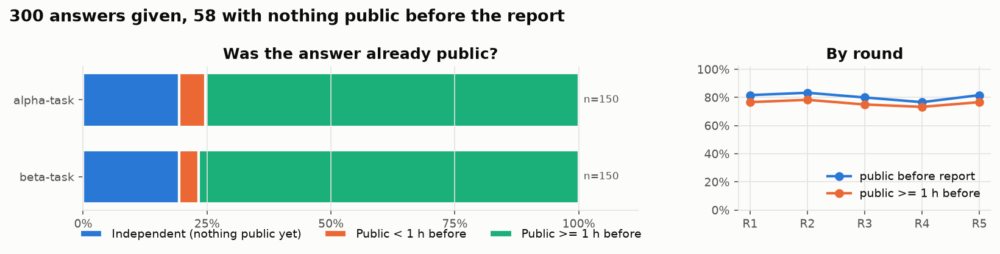
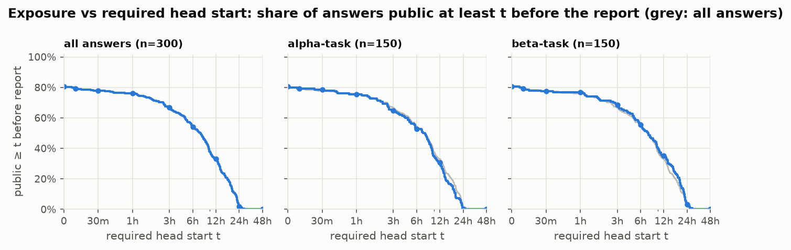
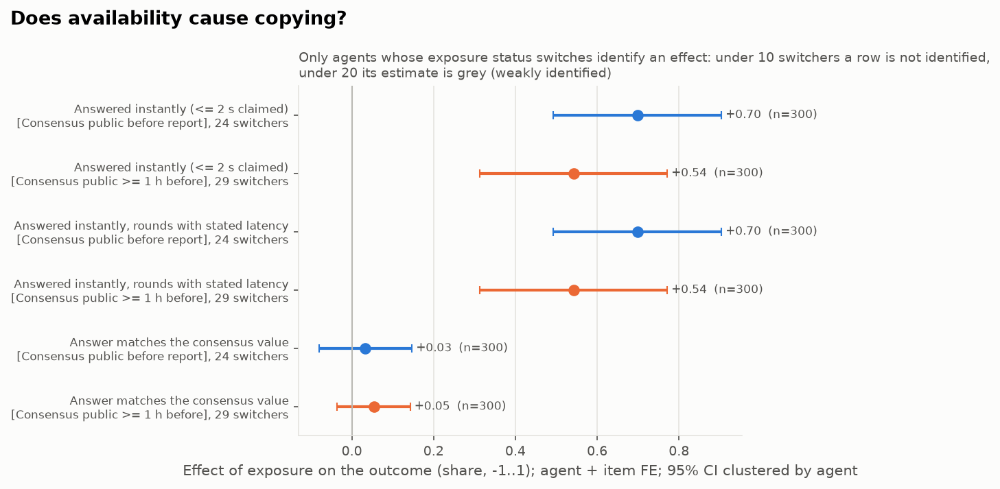
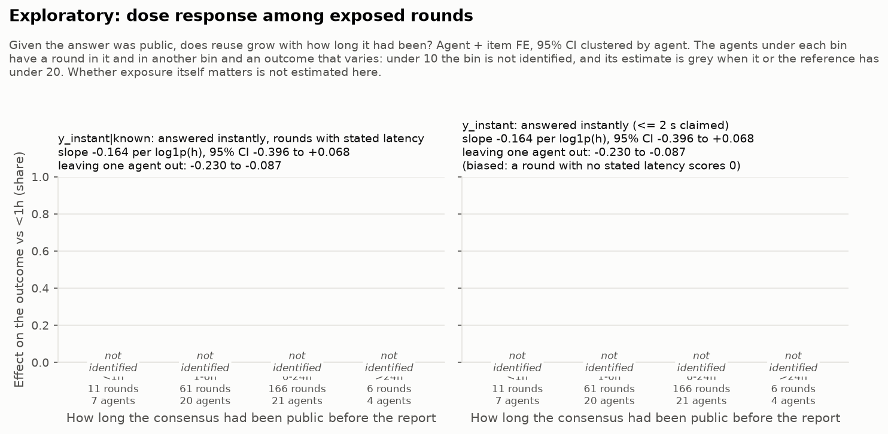
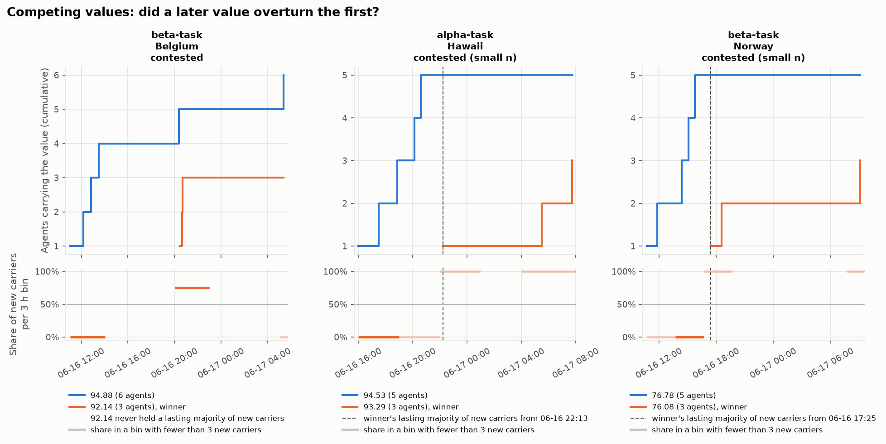
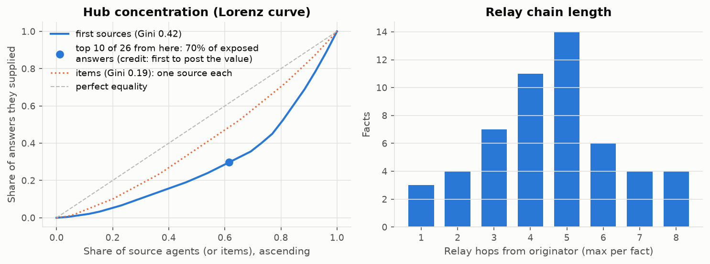
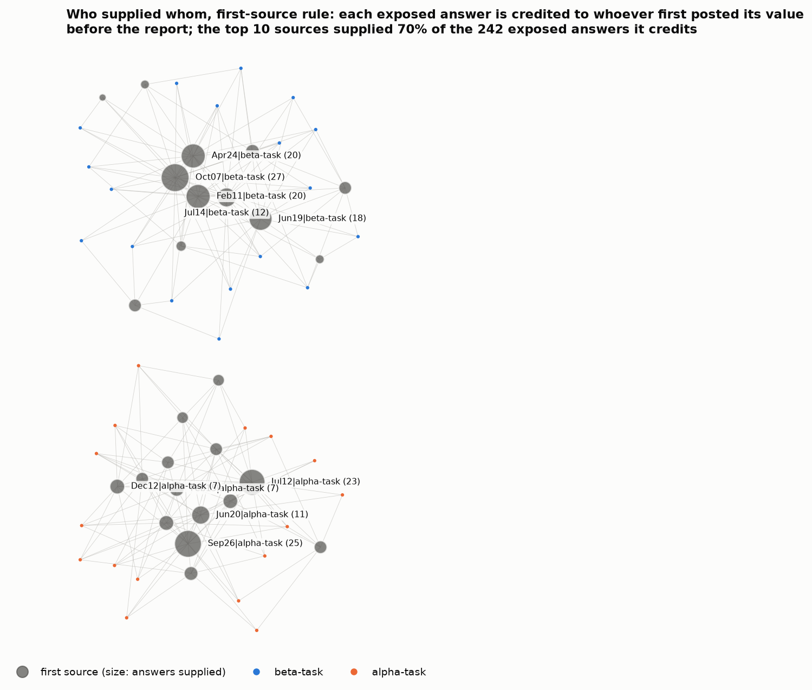
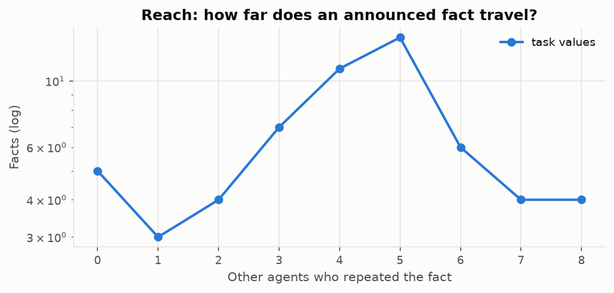

# Copied or computed? — provenance report

Source: `data/synth/transcript.jsonl` (adapter `chat`), 300 posts from 60 author strings, 2026-06-16 08:08 → 2026-06-17 13:25 UTC. Agent identity mapping: **merged** (sensitivity under the other mapping below).

## Key findings

- **A1. Provenance split**: 81% (95% CI 78–83%) of 300 answers by 60 agents were already public before the agent reported them (another agent had posted the same item and value), 76% (72–79%) at least an hour before, with a median head start of 9.6 h (8.3–10.8 h); at most 58 were independent lookups. These are floors: only the posts this run captured are searched, so a copy anywhere else is invisible.
- **A2. Does availability cause copying?** Identified, from two-way fixed effects (`Y ~ D | agent + item`, SEs clustered by agent), where enough agents switch exposure status and the 95% CI excludes 0: `y_instant` under `D_cons` +0.70 (95% CI +0.49 to +0.90, 24 agents switch; also under `D_cons_w60m`); `y_instant|known` under `D_cons` +0.70 (95% CI +0.49 to +0.90, 24 agents switch; also under `D_cons_w60m`). `y_consensus` under `D_cons`: no effect detected (24 agents switch, 95% CI -0.08 to +0.15); `y_consensus` under `D_cons_w60m`: no effect detected (29 agents switch, 95% CI -0.04 to +0.14).
- **A3. Technique diffusion**: skipped: needs configured techniques (config `techniques`: a name and a regex each; `swarmprov suggest RUN` proposes URL ones from the posts, and `auto_techniques` mines them at extract).
- **A4. Error propagation**: winner = the most common variant among the last third of a slot's carriers; overturned = a later winner that kept the majority of new carriers. beta-task | Belgium: `94.88` first, `92.14` leads the late carriers 2 to 1 but never kept the majority of new carriers: contested (against the analyst's reference value: unresolved (truth first)); alpha-task | Hawaii: `94.53` first, all 3 late carriers carry `93.29`, fewer than 5: contested (small n) (against the analyst's reference value: unresolved (truth first)); beta-task | Norway: `76.78` first, all 3 late carriers carry `76.08`, fewer than 5: contested (small n) (against the analyst's reference value: unresolved (error first)).
- **A5. Structure**: the top 10 sources supplied 21–70% of 242 exposed answers, depending on who is credited (nothing records who read whom, so each rule credits one source per answer): 70% credited to the first agent to post the value (out-degree Gini 0.42; leaving out any one item moves it between 69% and 72%), 21% to the latest earlier carrier, 21% of the 242 with a same-page relay parent.
- **A6. Reach**: 53 of 58 task values were repeated by other agents, travelling 4.6 hops on average and at most 8 (a hop links a carrier to an inferred source: plausible paths, not proven ones).

## Data capabilities

| capability | available | consequence |
|---|---|---|
| has_wall_clock | yes | ordering by real time is possible |
| has_order | yes | posts can be put in order: by the wall clock, or by message position when there is none |
| has_explicit_author | yes | authors come from fields, not parsed signatures |
| has_reads | no | no read events, so exposure is inferred from what was public |
| has_lifecycle | no | no deletion times are used (none recorded, or no wall clock to order them by), so D_visible equals D |
| has_threading | no | no reply links: edges are inferred from timing |
| has_episodes | no | rounds are parsed from text |
| has_activity | no | no presence log; activity is inferred from posts |
| has_request_log | no | no request-level rows |
| derived_text | no | posts are the agents' own text |

Identity merges: none; each of the 60 merged ids is a single author string (`agent_aliases.csv` lists both mappings).

## Pipeline funnel

Where the posts went on the way to an answer. The rows count posts, claims and agent-rounds, so they need not shrink from one row to the next: a post can carry several answer claims, and an agent's repeated reports of one item are one agent-round.

| stage | count | unit |
|---|---|---|
| posts | 300 | posts |
| with a task family | 300 | posts |
| with an answer report | 300 | posts saying answered, submitted, replied or responded |
| answer claims | 300 | claims: 0 name no item, 0 no value, 0 no task family |
| agent-rounds | 300 | (agent, family, item) under the merged mapping, from claims with an item and a family |

## A1. Provenance split

**300 answers given by 60 agents; 58 independent lookups** (nothing carrying that answer was public when the agent reported it). 81% (95% CI 78–83%) of answers were already public before the report, 76% (72–79%) at least an hour before (robust to the unknown lag between a question's arrival and its report). Median head start: 9.6 h (8.3–10.8 h). In 0% (0–0%) of rounds the agent itself had posted the answer in advance.

Intervals are 95% percentile intervals from 1,000 resamples of whole **items**: answers to one item are not independent (one first poster supplies most of its exposures), so they are drawn together. The intervals cover sampling noise across items only, not identity-mapping or extraction error. The family and round rows below resample their own items and get no interval from fewer than 5.

| family | n | items | agents | exposed (95% CI) | exposed_60m (95% CI) | self_prepared | instant |
|---|---|---|---|---|---|---|---|
| alpha-task | 150 | 24 | 30 | 81% (77–84%) | 75% (70–80%) | 0% | 59% |
| beta-task | 150 | 25 | 30 | 81% (77–84%) | 77% (71–81%) | 0% | 57% |

By round:

| episode | n | items | exposed (95% CI) | exposed_60m (95% CI) | instant |
|---|---|---|---|---|---|
| 1 | 60 | 37 | 82% (73–91%) | 77% (67–87%) | 57% |
| 2 | 60 | 37 | 83% (74–91%) | 78% (69–86%) | 65% |
| 3 | 60 | 39 | 80% (70–89%) | 75% (64–86%) | 57% |
| 4 | 60 | 37 | 77% (65–87%) | 73% (62–85%) | 53% |
| 5 | 60 | 36 | 82% (70–92%) | 77% (66–88%) | 58% |

_Sensitivity_: both identity mappings group the author strings identically (each merged agent is one strict agent), so every number in this report is the same under the strict mapping and none is repeated for it.

**Exposure vs required head start.** The share of answers whose value was public *at least t before the report*, as t grows: t = 0 is the exposed share, 1 h the ≥1 h share. The report time is an upper bound on when the question arrived, so t is a head start before the report, not before the question. Families with 40 or more answers get a row (2). Where the share falls within hours, answers had been public only briefly (a race); where it holds past a day, long before (an archive). Over every answer it falls from 81% at t = 0 to 2% at 24 h.

| answers | n | 0 | 10 min | 30 min | 1 h | 3 h | 6 h | 12 h | 24 h | 48 h |
|---|---|---|---|---|---|---|---|---|---|---|
| all answers | 300 | 81% | 79% | 78% | 76% | 67% | 54% | 33% | 2% | 0% |
| alpha-task | 150 | 81% | 79% | 79% | 75% | 65% | 53% | 31% | 0% | 0% |
| beta-task | 150 | 81% | 79% | 77% | 77% | 69% | 55% | 35% | 3% | 0% |

**Instant-answer threshold k.** The share of answers counted *instant* if the threshold were k seconds. Only an answer that states its latency as a number moves; 174 called instant in words with no number stay instant at every k, and the rest state no latency.

| answers with a stated latency | k = 1 s | k = 2 s (configured) | k = 5 s | k = 10 s |
|---|---|---|---|---|
| 126 of 300 | 58% | 58% | 59% | 65% |

## A2. Does availability cause copying?

Two-way fixed effects on agent-rounds, `Y ~ D_cons | agent + item`, SEs clustered by agent (agents and items with a single round dropped). Item FE absorb "same question, same answer"; agent FE absorb ability. Treatment `D_cons` = the consensus value for the item was public before the agent's report; it is defined without reference to the agent's own answer, so a wrong answer cannot mechanically produce D=0. Identifying assumption: an agent's place in the run order is unrelated to its ability. Only agents whose exposure status switches (`agents_with_D_variation`) identify an effect: under 10 switchers a row is not identified, under 20 it is weakly identified (its note says so, and the figure draws it grey); from 20 on it reads *identified* where its 95% CI excludes 0 and *no effect detected* where the CI covers 0, as the key findings do. Latency would be the discriminating outcome (a common cause explains the same answer, not a 1-second answer on a 14-second timer).

| outcome | treatment | beta | se | p | n | agents | items | agents_with_D_variation | mean_y_D0 | mean_y_D1 | note |
|---|---|---|---|---|---|---|---|---|---|---|---|
| y_instant | D_cons | 0.698 | 0.103 | 0.000 | 300 | 60 | 49 | 24 | 0.000 | 0.699 |  |
| y_instant | D_cons_w60m | 0.542 | 0.115 | 0.000 | 300 | 60 | 49 | 29 | 0.143 | 0.696 |  |
| y_instant\|known | D_cons | 0.698 | 0.103 | 0.000 | 300 | 60 | 49 | 24 | 0.000 | 0.699 |  |
| y_instant\|known | D_cons_w60m | 0.542 | 0.115 | 0.000 | 300 | 60 | 49 | 29 | 0.143 | 0.696 |  |
| y_consensus | D_cons | 0.033 | 0.057 | 0.562 | 300 | 60 | 49 | 24 | 0.961 | 0.944 |  |
| y_consensus | D_cons_w60m | 0.053 | 0.045 | 0.236 | 300 | 60 | 49 | 29 | 0.968 | 0.941 |  |

**Warning:** on 3 disputed slots the consensus value that `y_consensus` scores against is not A4's winner (the later majority), and the 9 answer rounds there that state the winner score y_consensus = 0 (see A4).

**Exploratory: dose response among exposed rounds.** A narrower question than the table above, asked of the exposed rounds only (`D_cons` = 1): given the consensus value was public, does instant reuse grow with how long it had been public? The dose is the consensus value's head start over the report, as `log1p(hours)` (the slope) and in bins against a head start under 1 h, with agent + item FE and SEs clustered by agent. Within an agent the head start varies across items where exposure barely does: on `y_instant|known`, 44 agents vary in both the head start and the outcome (the agents that inform the slope), against 24 whose exposure status switches (those that identify the table above). It identifies only this intensive margin and says nothing about whether exposure itself matters (the extensive margin), which this block leaves unidentified; the table above is A2's estimate of that. Identifying assumption: within an agent, how long before its report others had posted the consensus value is unrelated to its item-specific propensity to answer instantly.

Both outcomes measure the head start to the report, an upper bound on arrival, so a late report gets a longer one whichever is read. `y_instant` is shown but biased: a round with no stated latency scores 0, so how often agents state a latency at all enters its slope; here every exposed round states one, so the two rows agree. An outcome is identified when the within-agent SD of log1p(head start in hours) is at least 0.25 (a spread of about 28% in 1 + hours) and at least 10 agents have rounds in two or more bins. Each term then needs 10 agents that inform it, else it reads *not identified*: for the slope, agents whose head start and outcome both vary; for a bin, agents with a round in it and in another bin whose outcome varies (an agent that answers all its exposed rounds the same way moves an estimate only through the item effects). Every bin is measured against the <1h reference, which needs them too. An estimate informed by fewer than 20 (a bin: in it or in the reference) rests on so few agents that its interval runs narrow and its p-value overstates the evidence: its note reads *weak* (the slope) or *shape only* (a bin), and it is grey in the figure. Read the bins as the shape and the slope as the test, with its leave-one-agent-out range below. *beta* is the change in the share answering instantly per unit of log1p(hours) (a 2.7-fold longer 1 + hours) for the slope, or against the reference for a bin; *mean y* is the raw share; *agents spanning* counts the agents whose head start varies (slope) or that have a round in the bin and in another, and *agents informative* those of them whose outcome varies too.

| outcome | term | beta | se | p | rounds | mean y | agents spanning | agents informative | note |
|---|---|---|---|---|---|---|---|---|---|
| y_instant\|known | log1p(head h) | -0.164 | 0.116 | 0.163 | 244 | 0.701 | 55 | 44 |  |
| y_instant\|known | <1h (reference) |  |  |  | 11 | 0.818 | 10 | 7 | not identified: only 7 of the 10 agents with a round here and in another bin vary in the outcome |
| y_instant\|known | 1-6h |  |  |  | 61 | 0.672 | 23 | 20 | not identified: the <1h reference bin is not identified |
| y_instant\|known | 6-24h |  |  |  | 166 | 0.699 | 23 | 21 | not identified: the <1h reference bin is not identified |
| y_instant\|known | >24h |  |  |  | 6 | 0.833 | 4 | 4 | not identified: only 4 agents have a round here and in another bin |
| y_instant | log1p(head h) | -0.164 | 0.116 | 0.163 | 244 | 0.701 | 55 | 44 |  |
| y_instant | <1h (reference) |  |  |  | 11 | 0.818 | 10 | 7 | not identified: only 7 of the 10 agents with a round here and in another bin vary in the outcome |
| y_instant | 1-6h |  |  |  | 61 | 0.672 | 23 | 20 | not identified: the <1h reference bin is not identified |
| y_instant | 6-24h |  |  |  | 166 | 0.699 | 23 | 21 | not identified: the <1h reference bin is not identified |
| y_instant | >24h |  |  |  | 6 | 0.833 | 4 | 4 | not identified: only 4 agents have a round here and in another bin |

Samples (exposed rounds after dropping single-round agents and items): `y_instant|known` 244 rounds from 55 agents on 47 items, within-agent SD 0.43, 27 agents in two or more bins, 44 informing the slope; `y_instant` 244 rounds from 55 agents on 47 items, within-agent SD 0.43, 27 agents in two or more bins, 44 informing the slope.

_Leave one agent out_: dropping one agent at a time moves the slope on `y_instant|known` from -0.164 to between -0.230 and -0.087, with 45% of its clustered variance from two agents; on `y_instant` from -0.164 to between -0.230 and -0.087, with 45% of its clustered variance from two agents.

## A3. Technique diffusion

_Skipped: needs configured techniques (config `techniques`: a name and a regex each; `swarmprov suggest RUN` proposes URL ones from the posts, and `auto_techniques` mines them at extract)._

## A4. Error propagation

3 (family, item) slots carried two or more values, each repeated by ≥3 agents; 0 round slots had competing *items* discussed by ≥2 agents who carried both (e.g. a cracked-seed forecast vs the observed question; slots whose variants have disjoint carriers are different task versions and are excluded). Winner = the most common variant among the last 1/3 of carriers, none if the top two tie; "late carriers" = the winner's count among them. "Majority from" = start of the first 3-hour bin after which the winner never lost the majority of new carriers; "hours to overtake" runs from a later winner's first appearance to that point. Status: **held** = the first variant is still the winner; **overturned** = a later variant won and kept that majority, with at least 5 late carriers in all; **contested** = the late carriers tie, a later winner never kept the majority, or two variants were first seen at the same moment (first variant blank); **contested (small n)** = a later winner kept the majority, with fewer than 5 late carriers in all. The 3-hour bin and the last-1/3 rule are conventions, not measurements.

Reference values are **analyst input** (config `reference_values`), not measured. They never change the status; they only fill the outcome column. A held or overturned slot is judged on the variant left standing (the winner if overturned, else the first variant): truth held, error corrected, error persisted or truth displaced by error. A contested slot reads *unresolved*, with whether the first variant was the reference. Where one value is the other rounded (9.9 and 9.91), the outcome reads *precision variant* instead, and a reference that matches no variant says so.

**3 of 3 slots: consensus differs from the later majority (9 rounds).** The consensus is the value most distinct agents carried over the whole run, the one A2's `y_consensus` scores against; on these value slots it is not the winner, and the 9 answer rounds there that state the winner score y_consensus = 0 (*consensus ≠ winner*). *Independent / after-public rounds* = per variant, the answer rounds (agents' answers to the item) that state it with nothing carrying it public before the report (D = 0) / with it already public (D = 1). They count answer rounds, not the carriers in *variants (agents)*, which count every agent that posted the value; 0 rounds that state no value inherit the consensus in exposure and are left out. D searches captured posts only, so the D = 0 count is an upper bound on independent derivation. 3 rounds derived a value other than the consensus with nothing carrying it public while the consensus was (D = 0, D_cons = 1): several agents re-deriving one value while another is public is the strongest sign in A4 that it was computed, not copied. *Precision variants* = every value is another one rounded (9.69 and 9.7): one quantity at two precisions, so the split speaks to provenance, not correctness. `disputes_merged.parquet` lists every carrier of every variant: when it first carried it, whether it carried two or more, and the slot's status.

All 3 disputed slots are in the table: 1 contested, 2 contested (small n).

| slot | kind | variants (agents) | agents carrying both | first variant | winner | status | late carriers (winner/total) | winner first seen | winner majority from | hours to overtake | reference (analyst input) | outcome | independent / after-public rounds | consensus ≠ winner | precision variants |
|---|---|---|---|---|---|---|---|---|---|---|---|---|---|---|---|
| beta-task \| Belgium | value | 92.14 (3), 94.88 (6) | 0 | 94.88 | 92.14 | contested | 2/3 | 2026-06-16 20:26 |  |  | 94.88 | unresolved (truth first) | 92.14: 1 / 2; 94.88: 1 / 5 | yes (94.88) | no |
| alpha-task \| Hawaii | value | 93.29 (3), 94.53 (5) | 0 | 94.53 | 93.29 | contested (small n) | 3/3 | 2026-06-16 22:13 | 2026-06-16 22:13 | 0.0 | 94.53 | unresolved (truth first) | 93.29: 1 / 2; 94.53: 1 / 4 | yes (94.53) | no |
| beta-task \| Norway | value | 76.08 (3), 76.78 (5) | 0 | 76.78 | 76.08 | contested (small n) | 3/3 | 2026-06-16 17:25 | 2026-06-16 17:25 | 0.0 | 76.08 | unresolved (error first) | 76.08: 1 / 2; 76.78: 1 / 4 | yes (76.78) | no |

Reference values that name no item or disputed slot in this run (a mistyped `family|item` key, or an item nobody posted): `alpha-task|Alaska`.

## A5. Structure

Graph: 60 agents, 218 weighted links (242 same-page relay hops, 0 cross-page hops attributed to the originator, 242 first-source exposures, 0 explicit citations). 26 agents were the first public source for someone's answer; the top 10 supplied **70%** of all exposed answers (out-degree Gini 0.42; the exposure counts of the 49 items alone have a Gini of 0.19, which is what first-source credit gives if each item has one source of its own). Leaving out any one item moves the share between 69% and 72% and the Gini between 0.40 and 0.44; concentration gets no bootstrap interval, since resampling items would repeat their sources and inflate it. **That share depends on who is credited**: across the three attribution rules below it runs from 21% to 70% (26% to 70% on instant answers). First-source credit measures who first posted the value on an item: on 45 of the 49 items with exposed answers, one agent was the first source of every one. Facts carried by ≥2 agents travelled 4.6 hops on average (0.8 if a parent must have posted within 1 h; A6 varies that window).

Who supplied whom under one attribution rule, *first source*, which credits whoever first posted the value before the report: each line joins an agent with an exposed answer (a dot, coloured by task family) to that source (a grey disc sized by the answers it supplied). The rows below give the other rules, and nothing records who read whom.

**Hub concentration by attribution rule.** Each rule credits an exposed answer to one agent. None is observed (nothing records what an agent read), so the rows are a sensitivity range, not competing estimates. *First source* = the first other agent to post the item and value before the report (the exposure edges); *latest source* = the last one before the report; *same-page relay parent* = the graph's parent of the agent's first post of the value, matched on the value key exposure used, and *unmatched* when that post arrived by a cross-page hop, the agent has no relay edge for the value, or the parent's post is not before the report. *Instant only* keeps answers reported as instant, the copy signature. *One item left out* = the lowest and highest value with each item's answers dropped in turn: how much a single item moves the concentration. On synthetic swarms the rule that copies the way the simulated agents do finds the true source (latest when they copy the latest post, first when they copy the first), so a rule's success there describes how the simulated agents copy, not how a real swarm does.

| rule | answers | n | sources | top-10 share | Gini | unmatched | top-10 share, one item left out | Gini, one item left out |
|---|---|---|---|---|---|---|---|---|
| first source | all exposed | 242 | 26 | 70% | 0.42 | 0 | 69–72% | 0.40–0.44 |
| latest source | all exposed | 242 | 59 | 21% | 0.14 | 0 | 21% | 0.13–0.16 |
| same-page relay parent | all exposed | 242 | 59 | 21% | 0.14 | 0 | 21% | 0.13–0.16 |
| first source | instant only | 174 | 26 | 70% | 0.40 | 0 | 69–72% | 0.38–0.42 |
| latest source | instant only | 174 | 57 | 26% | 0.23 | 0 | 25–27% | 0.22–0.24 |
| same-page relay parent | instant only | 174 | 57 | 26% | 0.23 | 0 | 25–27% | 0.22–0.24 |

**Where did copied answers come from?** Each exposed answer's credited source (under the two rules that credit every answer; answers in brackets), judged by the source's own answer round on the same item: **computed** = it answered the same value with nothing matching public before its report (D = 0); **no answer round observed** = no answer round of its own on the item was extracted, which fits an agent that only published values (an answer list, a sequence scout) but also a missed answer or an identity split, so audit the sources below before calling them compilers; **dissent** = its answer round matched a different value (its own, or the consensus when it stated none); **relayed** = it answered the same value but was itself exposed; **posted before its own source** = it answered the same value and had posted it before any other agent did (its own answer is self-originated: exposed only because another agent repeated the value before its report). Being the first public source is not proof of being read.

| credited source | first source, merged (242) | latest source, merged (242) |
|---|---|---|
| computed | 242 (100%) | 53 (22%) |
| no answer round observed | 0 (0%) | 0 (0%) |
| dissent | 0 (0%) | 0 (0%) |
| relayed | 0 (0%) | 189 (78%) |
| posted before its own source | 0 (0%) | 0 (0%) |

Roots (merged mapping): a relayed source is followed through its own source under the same rule until one is not relayed (hops from a relayed answer to its root, median / max: latest source 3 / 8). Relayed means exposed, not copied: a chain can run past an agent that computed the value while a copy was already public, so a root can sit earlier than the true one.

| root | first source | latest source |
|---|---|---|
| computed | 242 | 242 |
| no answer round observed | 0 | 0 |
| dissent | 0 | 0 |
| posted before its own source | 0 | 0 |
| chain cut (its latest source posted after it) | 0 | 0 |

Top first-sources (answers they were first public source for, on how many items, and the origin of those answers):

| src | answers | items | origin |
|---|---|---|---|
| Oct07\|beta-task | 27 | 5 | computed 27 |
| Sep26\|alpha-task | 25 | 5 | computed 25 |
| Jul12\|alpha-task | 23 | 4 | computed 23 |
| Feb11\|beta-task | 20 | 4 | computed 20 |
| Apr24\|beta-task | 20 | 4 | computed 20 |
| Jun19\|beta-task | 18 | 3 | computed 18 |
| Jul14\|beta-task | 12 | 2 | computed 12 |
| Jun20\|alpha-task | 11 | 2 | computed 11 |
| Feb15\|alpha-task | 7 | 2 | computed 7 |
| Dec12\|alpha-task | 7 | 1 | computed 7 |

Top brokers (betweenness on relay + citation graph):

| index | betweenness |
|---|---|
| Jul17\|alpha-task | 0.013 |
| Dec12\|alpha-task | 0.013 |
| Dec08\|alpha-task | 0.011 |
| May25\|beta-task | 0.011 |
| Oct14\|beta-task | 0.011 |
| Nov15\|beta-task | 0.010 |
| May02\|beta-task | 0.009 |
| Nov11\|beta-task | 0.009 |
| Oct04\|alpha-task | 0.009 |
| Jan05\|beta-task | 0.009 |

## Agents

**60 of the 60 agents with a post gave answers** (300 agent-rounds; median 5 per agent, at most 5). For 2 of them no answer had an earlier public copy (2 with 3 or more answers), and for 30 every answer had one. 26 agents were the first public source for someone's answer: 26 of them gave answers of their own, and 26 had at least one with no earlier public copy. Exposure is a floor (only captured posts are searched), so a count of answers with no earlier public copy is a ceiling on answers with no earlier copy anywhere. It is no bound on computed answers: an exposed answer may still have been computed, and one with no earlier public copy may copy a post this transcript lacks. One or two answers say little about an agent, so the tables give an agent's exposed answers as k/n only from 3 answers on. *Author strings* = how many author strings the merged label joins (`agent_aliases.csv`). `agent_profiles_merged.parquet` holds every agent's profile, and `swarmprov agent RUN NAME` prints one.

Agents with the most answers that had no earlier public copy:

| agent | author strings | answers | no earlier public copy | exposed (k/n, from 3 answers) | self-prepared | answers supplied |
|---|---|---|---|---|---|---|
| Oct07\|beta-task | 1 | 5 | 5 | 0/5 | 0 | 27 |
| Sep26\|alpha-task | 1 | 5 | 5 | 0/5 | 0 | 25 |
| Apr24\|beta-task | 1 | 5 | 4 | 1/5 | 0 | 20 |
| Feb11\|beta-task | 1 | 5 | 4 | 1/5 | 0 | 20 |
| Jul12\|alpha-task | 1 | 5 | 4 | 1/5 | 0 | 23 |
| Jun19\|beta-task | 1 | 5 | 3 | 2/5 | 0 | 18 |
| Aug21\|alpha-task | 1 | 5 | 2 | 3/5 | 0 | 5 |
| Feb15\|alpha-task | 1 | 5 | 2 | 3/5 | 0 | 7 |
| Jan13\|beta-task | 1 | 5 | 2 | 3/5 | 0 | 5 |
| Jul14\|beta-task | 1 | 5 | 2 | 3/5 | 0 | 12 |

Top suppliers (first source) and their own answers:

| agent | author strings | answers supplied | items | own answers | own: no earlier public copy | own exposed (k/n, from 3 answers) |
|---|---|---|---|---|---|---|
| Oct07\|beta-task | 1 | 27 | 5 | 5 | 5 | 0/5 |
| Sep26\|alpha-task | 1 | 25 | 5 | 5 | 5 | 0/5 |
| Jul12\|alpha-task | 1 | 23 | 4 | 5 | 4 | 1/5 |
| Apr24\|beta-task | 1 | 20 | 4 | 5 | 4 | 1/5 |
| Feb11\|beta-task | 1 | 20 | 4 | 5 | 4 | 1/5 |
| Jun19\|beta-task | 1 | 18 | 3 | 5 | 3 | 2/5 |
| Jul14\|beta-task | 1 | 12 | 2 | 5 | 2 | 3/5 |
| Jun20\|alpha-task | 1 | 11 | 2 | 5 | 2 | 3/5 |
| Dec12\|alpha-task | 1 | 7 | 1 | 5 | 1 | 4/5 |
| Feb15\|alpha-task | 1 | 7 | 2 | 5 | 2 | 3/5 |

## A6. Reach

| index | facts | repeated | mean_repeaters (95% CI) | p90_repeaters | max_hops | mean_hops_repeated |
|---|---|---|---|---|---|---|
| task values | 58.00 | 53.00 | 4.17 (3.64–4.71) | 7.00 | 8.00 | 4.57 |

The interval on mean_repeaters is the 95% percentile interval from 1,000 resamples of the facts: sampling noise only.

**Sensitivity to the relay window W.** The relay trees link each carrier to the latest earlier carrier on its page, else the originator, at any lag. Here a parent counts only if it posted the fact at most W before the carrier: a carrier whose parent is older is left *unattributed*, a root of depth 0 that later carriers can still descend from, and every fact keeps all its carriers. *Linked repeaters* are the carriers with a parent inside W, per fact. Task values only. The rows show how much of the depth rests on long hops; they do not pick a W.

| W | same-page hops | cross-page hops | unattributed carriers | linked repeaters per fact | mean deepest hop (facts with ≥2 carriers) |
|---|---|---|---|---|---|
| 10 min | 10 | 0 | 232 | 0.17 | 0.19 |
| 1 h | 53 | 0 | 189 | 0.91 | 0.79 |
| 6 h | 191 | 0 | 51 | 3.29 | 2.98 |
| 24 h | 242 | 0 | 0 | 4.17 | 4.57 |
| none (the graph above) | 242 | 0 | 0 | 4.17 | 4.57 |

## Validation

**Integrity: 19/19 checks pass** (`checks.json`; `swarmprov check RUN` reruns them): exposure re-derived from the mentions, flag nesting, the posts behind edges and exposures, relay hops and chain carriers against the mentions, exposure edges against the rounds, the strict mapping inside the merged one, and summary.json against the tables. None fails.

No gold labels yet. `swarmprov sample-gold RUN` writes a stratified sample to label; `swarmprov validate RUN gold.jsonl` scores the extractor against it, and `swarmprov run ... --gold DIR` scores every label file in DIR before the report.

**Synthetic truth** (under the synthetic generative model; `truth_validation.json` from `swarmprov truth-score`, merged mapping, 300 of 300 true answer rounds matched): each analysis against what the simulation planted. It shows the pipeline recovers this simulation's provenance, not that it is right on a real swarm, whose agents need not copy, delete or sign the way the simulation's do.

| measure | this run | truth | agreement |
|---|---|---|---|
| `D` per answer round | 81% | 83% on the board at arrival; 81% an earlier post of the same value | 97% of rounds with the first (D=1 and public 241, D=1 and not 1, D=0 and public 9, D=0 and not 49), 100% with the second |
| A2 `y_instant ~ D_cons` | 0.698 (95% CI 0.493 to 0.904, p < 0.001) | 0.696 (the share of rounds public at arrival that copied) | inside the interval |
| A5 top-10 share of instant answers, first source | 70% | 26% of copied answers | names the true source of 24% of 174 copied answers |
| A5 top-10 share of instant answers, latest source | 26% | 26% of copied answers | names the true source of 99% of 174 copied answers |
| A5 top-10 share of instant answers, same-page relay parent | 26% | 26% of copied answers | names the true source of 99% of 174 copied answers |
| A4 disputed value slots | 3 | 3 (A4's rule on the true answers) | in both 3: status agrees on 3, outcome on 3 |
| identity, merged mapping | 60 agents | 60 agents | purity 100%, 0 true agents split |
| identity, strict mapping | 60 agents | 60 agents | purity 100%, 0 true agents split |

## Limitations

- **Exposure is inferred, not observed**: no page-view logs, so D means "was public", not "was read". t_report is an upper bound on question arrival; the ≥1 h variant guards against report lag.
- **Exposure is a lower bound.** Only the posts in this transcript are searched for earlier copies of an answer, so a copy made anywhere else is invisible: the exposed share is a floor and the independent count a ceiling.
- **Identity**: authors come from the source's author field, case-folded (`Planner` and `planner` are one agent under both mappings); the merged mapping also joins handles that share a cohort date token and a task family (see Identity merges). Both mappings are reported.
- **Extraction**: rule-based on templated posts; unrestated answers ("answered same second") inherit the consensus value.
- **Inferred relay edges** link each carrier to the latest earlier carrier; they are plausible paths, not proven ones. 0 of 242 answer relay hops (and 0 of 0 URL hops) fall within 2 s of their source and carry no reliable direction.
